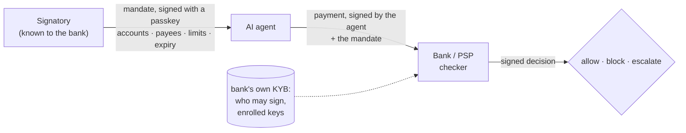

# Gleipnir

**Know Your Agent for bank transfers.** A power of attorney for AI agents that any bank can check.

AI agents are starting to pay supplier invoices by SEPA, ACH, Faster Payments and wire. Gleipnir lets the bank verify, before it executes, that a person who may sign for the company actually allowed this agent to make this payment: from this account, to this payee, up to this amount, until this date. Open spec, Python and TypeScript, Apache-2.0.



## Why

- **Cards have KYA, transfers don't.** Card networks are building agent checks for card payments. For bank transfers there are per-platform limits, but no shared check a bank can run on "was this agent authorized by the company?".
- **The scam agents fall for first is "we changed our bank details".** A payee list on the mandate blocks it: a changed IBAN is a different payee.
- **Someone will ask "prove it" months later.** Mandate + payment + signed decision is a receipt anyone can verify offline, without the bank or us.

## How it works

1. **Mandate.** A person who may sign for the company (alone, or two together where company law requires joint signing; or on the strength of a signed CEO → CFO delegation) signs what one agent may pay. They sign in their bank's app or on a static passkey page.
2. **Payment.** The agent signs every payment with its own key and attaches the mandate.
3. **Check.** Before executing, the bank checks the signatures, that the signer may sign for the company and with that key, **from its own KYB records, never from the mandate**, that nothing is revoked or expired, that the company holds the debtor account, that the payee, rail and amounts are covered, and that it is not a replay. 23 steps, deterministic ([spec §7](spec/mandate.md#7-check)).
4. **Decision.** Allow, block, or send to a person. The bank signs the decision, which becomes the receipt.

Gleipnir does not move money and does not verify identities: the bank (KYB) or a vLEI issuer does that once, and everything after is a signature. See the [chain of trust and threat model](spec/mandate.md#11-threat-model).

## What's in the repo

| | |
|---|---|
| **Spec** | [spec/mandate.md](spec/mandate.md), v0.4 draft: enrollment, multi-signature, delegation, debtor accounts, accounts and rails worldwide, ISO 20022 pain.001, overrides, signed status, revocation and revocation lists, bank key sets, receipts, closed shapes and versioning, threat model, reason codes, conformance |
| **Reference checker** | Python `gleipnir_verify.mandate` |
| **TypeScript port** | `@getgleipnir/verify/mandate` (Node and browsers), same results on every test vector |
| **Test vectors** | [137 shared cases](typescript/packages/verify/test/fixtures/mandate-vectors.json): both implementations run them and verify each other's decisions; plus pinned problems, key sets and byte-identical pain.001 XML |
| **CLI** | `gleipnir mandate keygen · issue · sign · delegate · pay · check · override · resolve · status · revoke · revocations · keyset · pain001 · verify · serve · mcp` |
| **Bank side** | `gleipnir mandate serve`: reference `POST /check` and `POST /resolve` server, with `/.well-known/gleipnir-checker.json` and a signed `GET /revocations` list |
| **Agent side** | MCP server (Python, or `npx gleipnir-mandate-mcp`) for Claude, Cursor and any MCP client |
| **Signatory side** | [site/mandate](site/mandate/index.html): review a mandate and sign it with a passkey; no network |
| **Use cases** | all [21 scenarios](python/gleipnir-verify/tests/test_mandate_usecases.py) as named tests, from issuing to a dispute three months later |

## Quickstart: from nothing to a signed decision

```bash
git clone https://github.com/getgleipnir/gleipnir && cd gleipnir && alias g="uv run gleipnir mandate"
for k in signer agent bank; do g keygen -o $k.pem; done
g issue --id m_ap --company "Nordhafen Logistik GmbH" --country AT --signer-id kberger@nordhafen.at --signer-key signer.pem \
  --agent-id ap-agent --agent-key agent.pem --currency EUR --max-per-payment 25000.00 \
  --max-per-period 100000.00/P1M --from-account "AT48 3200 0000 1234 5864" \
  --payee "Brenner Stahl AG=AT611904300234573201" -o mandate.json
g sign mandate.json --key signer.pem && g kyb mandate.json -o kyb.json   # kyb: dev stand-in for the bank's records
g pay mandate.json --id p_1 --amount 18400.00 --payee "Brenner Stahl AG=AT611904300234573201" --agent-key agent.pem -o p1.json
g check mandate.json p1.json --authority kyb.json --bank-key bank.pem -o decision.json   # allow, exit 0
```

Change the IBAN in `pay` and `check` blocks it (`payee_not_on_mandate`, exit 1); correct it and the same payment id goes through. Go over 25 000.00 and it escalates (`over_payment_limit`, exit 3); `g override p_2.decision.json --key signer.pem --signer-id kberger@nordhafen.at -o o.json` and `g resolve mandate.json p_2.json p_2.decision.json o.json --authority kyb.json --bank-key bank.pem` approve it. Resend `p_1` and you get the same decision back, booked once. `g revoke mandate.json --key signer.pem --id r_1 -o rev.json`, then `check ... --revocation rev.json` blocks with `mandate_revoked`. `g verify decision.json --bank-pub bank.pem` checks the bank's signature; an edited decision is INVALID.

## Two signers and delegation

```bash
g keygen -o hofer.pem
g issue ... --cosigner mhofer@nordhafen.at=hofer.pem --threshold 2 -o joint.json   # joint signing: both must sign
g sign joint.json --key signer.pem && g sign joint.json --key hofer.pem           # each with their own key

g delegate --id g1 --company "Nordhafen Logistik GmbH" --from-id ceo@nordhafen.at --key ceo.pem \
  --to cfo@nordhafen.at=cfo.pem --currency EUR --max-per-payment 50000.00 --max-per-period 200000.00/P1M \
  --from-account "AT48 3200 0000 1234 5864" -o g1.json
g issue ... --signer-id cfo@nordhafen.at --signer-key cfo.pem --delegation g1.json -o cfo.json
g revoke g1.json --key ceo.pem --id r_g1 -o r_g1.json                              # cuts everything below
```

A delegate can never grant more than they received, and a link's monthly limit is shared by every mandate under it.

## Accounts worldwide

IBAN is Europe, the Middle East and some of Africa and Latin America. Elsewhere banks address accounts their own way, so accounts are typed: `--payee "Supplier=us_aba:021000021/123456789"`, `uk_sort_code:601613/31926819`, `ca_eft:004/54321/7654321`, `au_bsb:033000/87654321`, `in_ifsc:SBIN0000300/00000012345678`, `mx_clabe:002010077777777771`, `swift:MHCBJPJT/1234567`. IBAN, ABA and CLABE check digits are verified, and each rail only carries its own schemes and currency (SEPA: IBAN in EUR; ACH: ABA in USD; wire: anything). [Spec §6.1](spec/mandate.md#61-accounts-and-rails).

## Libraries

Python: [examples/mandate_demo.py](examples/mandate_demo.py) walks through allow, a changed IBAN and its correction, an amount over the limit approved by an override, a resend, a forged decision, a CFO who leaves, and a second bank with and without vLEI (`uv run python examples/mandate_demo.py`).

```python
from gleipnir_verify import mandate as m
bank = m.Checker(id="bank:ATXX", sk=bank_key, authority=kyb_lookup, ledger=ledger, payments=payment_log)
decision = bank.check(mandate, payment)          # {"outcome": "allow" | "block" | "escalate", "reasons": [...], "sig": ...}
m.verify_receipt(mandate, payment, decision, bank_public_keys)   # offline, months later
```

TypeScript: the same API in camelCase, with an async `check` and amounts as bigint minor units. Parse wire input with `parseStrict`, not `JSON.parse`: once parsed, JavaScript cannot tell `2.0` from `2`, and the spec refuses floats.

```ts
import { Checker, parseStrict, verifyDecision } from "@getgleipnir/verify/mandate";
const bank = new Checker({ id: "bank:ATXX", seed, authority: kybLookup, ledger, payments });
const decision = await bank.check(parseStrict(mandateText), parseStrict(paymentText));
```

A bank plugs in its own authority source (`authority(company, person_id)`), account records (`holds(company, account)`), payment log (`lookup`, `register`, `remember`, `forget`, `take`) and period ledger (`reserve`, `release`). The CLI's `.gleipnir/mandate-state/` file is a development stand-in for both.

## For agents, signatories and banks

**Agents.** An MCP server any MCP client can run (Claude Desktop, Cursor, Claude Code), in Python or as an npm binary:

```json
{"mcpServers": {"gleipnir-mandate": {"command": "npx", "args": ["-y", "-p", "@getgleipnir/sdk", "gleipnir-mandate-mcp",
  "--mandate", "/path/mandate.json", "--agent-key", "/path/agent.pem", "--bank-url", "http://127.0.0.1:8787"]}}}
```

(Python: `"command": "uv", "args": ["run", "--project", "/path/to/gleipnir", "gleipnir", "mandate", "mcp", ...]`, or `gleipnir mandate mcp --http 8788` for Streamable HTTP with an Origin allow-list and a bearer token.)

Four tools and one resource: `mandate_scope` (what may I pay), `request_mandate` (an unsigned draft for a person to sign; the agent never signs one itself), `attach_mandate` (a payment signed with the agent key), `check_payment` (asks the bank's checker before paying: allow, block or escalate, with advice); `gleipnir://mandate/current` is the mandate itself.

**Signatories.** [site/mandate](site/mandate/index.html) is a single static page: paste or open a draft, read what the agent may pay (payees, limits, validity, delegation), sign with a passkey, alone or as one of several co-signers. It makes no network requests. The passkey signs `SHA-256("gleipnir/mandate/v0.4\n" || mandate_hash)`, so the signature is valid for this mandate and nothing else.

**Banks.** A reference HTTP checker (JSON only, Origin allow-list, no auth: put it behind your own gateway):

```bash
g serve --authority kyb.json --bank-key bank.pem --port 8787   # POST /check, POST /resolve, GET /keys, POST /revoke,
                                                               # GET /.well-known/gleipnir-checker.json, GET /revocations
g pain001 m.json p.json --decision d.json -o pain.xml   # ISO 20022 message carrying the hashes
g pain001 m.json p.json --check pain.xml                     # before executing: MATCHES or MISMATCH
```

## Status and security

- **Draft 0.4.** The format may still change; feedback from payment, fraud and compliance people is very welcome.
- **Audited four times** by independent reviewers who wrote every attack as a test: [first audit](docs/audit-2026-10-23.md), [second audit and re-verification](docs/audit-2026-10-23-evening.md) (23.10.2026), [third audit, spec 0.3](docs/audit-2026-10-24.md) (24.10.2026), [fourth audit, spec 0.4](docs/audit-2026-10-24-v04.md) (24.10.2026). Every finding is fixed or documented, with regression tests.
- **Not solved by design:** a fake invoice from a real payee within the limits, collusion between real signatories, a compromised signer phone within the signed scope. They are bounded and visible in the receipt; see [residual risks](spec/mandate.md#11-threat-model).
- **Open:** a standard revocation-list format, joint signing inside delegation links, ISO 20022 mapping, real vLEI (ACDC/KERI) credential verification (today vLEI is an authority source).

---

## Earlier work: action records for AI agents

Before KYA, this repo started as signed, anchored records of what an agent did, verifiable by a third party. That code is unchanged and still tested.

AI agent vendors get stuck in their buyers' security reviews because they can't prove what their agent did: their logs are self-written, so the buyer can't verify them. Gleipnir records each agent action together with the real outcome in the external system, signs it, anchors it outside the vendor, and lets the buyer, auditor or insurer verify it independently.

```python
import gleipnir

rec = gleipnir.Recorder(agent_id="support-agent", agent_version="3.2.4", anchor="rekor")

def refund_booked(call, response):
    r = payments.get_refund(response["refund_id"])          # read back from the system of record
    return gleipnir.Outcome.compare({"amount": call.args["amount"]}, {"amount": r.amount})

@rec.tool(system="payments-api", redact=["card_number"], verify_outcome=refund_booked)
def issue_refund(order_id: str, amount: int, card_number: str) -> dict:
    return payments.refund(order_id, amount, card_number)

rec.pack("security-review-pack.zip")   # summary.html, actions.csv, bundle.zip
```

The buyer checks the bundle offline, with no account and no access to the vendor:

```bash
pipx run gleipnir-verify bundle.zip --expect-key k_ed25519_... --require-anchor rekor --require-full
```

### Zero-code: any MCP client

Put `gleipnir-mcp` in front of a local MCP server in Claude Desktop, Cursor or Claude Code and every tool call through it gets a signed record, with no code changes:

```bash
gleipnir-mcp --print-config claude-desktop -- npx -y @modelcontextprotocol/server-filesystem ~/Desktop
gleipnir report --open      # what my agent did
```

See [docs/mcp-proxy.md](docs/mcp-proxy.md).

### Try it in one minute

```bash
git clone https://github.com/getgleipnir/gleipnir && cd gleipnir
uv run gleipnir demo --open
```

A support agent issues refunds through a payments API with a hidden bug. The agent reports every refund as done; Gleipnir reads each one back from the payments system and records two mismatches. Then the demo verifies the records as a buyer would (VALID), edits one record to hide a mismatch, and verifies again (INVALID: bad signature, broken chain). You get `gleipnir-demo/summary.html`, the evidence report a buyer would read, plus the bundle anyone can check offline:

```
  T-102  refund  180.00  agent says done, system booked 179.50  <- outcome mismatch
  ...
  1. Verify as the buyer would            VALID
  2. Edit record 2 to hide the mismatch   INVALID: bad_signature, broken_chain
```

No API keys, no network. The same agent as readable code, step by step: [examples/refund-agent](examples/refund-agent).

### What's in the box

**Recording (vendor side)**

| | |
|---|---|
| `gleipnir-sdk` (`import gleipnir`) | `Recorder.tool` decorator (sync and async), outcome read-back checks, field redaction, context (identity, scope, model, prompt versions) |
| Outcome checks | `gleipnir.outcomes`: ready-made read-backs from the system of record for Stripe, Zendesk, Salesforce, Intercom, HubSpot, Jira, ServiceNow, Shopify and any HTTP/JSON API; inject your own client, money in minor units, bounded retries. See [docs/outcome-checks.md](docs/outcome-checks.md) |
| Adapters | MCP client middleware, OpenTelemetry span exporter (GenAI semantic conventions), OpenAI Agents SDK, Claude Agent SDK hooks, LangChain/LangGraph callback handler, Playwright (browser and computer-use agents: navigations, clicks, fills with values redacted, submits, downloads, screenshot hashes), Temporal activity interceptor (every attempt, retries visible, replay-safe). See [docs/adapters.md](docs/adapters.md) |
| `gleipnir-mcp` | Zero-code stdio MCP proxy that records every `tools/call`, plus `gleipnir report` |
| Approvals | `rec.approve(...)` binds a human approval to one exact action; the verifier checks it came first and matches. Signed approvals (`signature=`, from an approver key via `gleipnir approve sign` or a passkey on `site/approve/`) are checked against the buyer's own list of approvers: `gleipnir-verify --approvers approvers.json --require-signed-approvals` |
| Keys | Ed25519 by default; AWS KMS, Google Cloud KMS and Azure Key Vault signers (Ed25519 or ECDSA P-256), so the key never sits in the agent process |
| Anchoring | Segment hashes in Sigstore Rekor v2 plus RFC 3161 trusted timestamps; only hashes leave your infrastructure |
| Copies and retention | Sinks for a buyer-held copy, S3 Object Lock (WORM), webhooks and Splunk HEC; OCSF export for SIEMs; retention declared in a signed config record |

**Checking (buyer, auditor, insurer side)**

| | |
|---|---|
| `gleipnir-verify` | Small offline verifier: signatures, hash chain, Merkle roots, Rekor inclusion proofs and checkpoints, trusted timestamps, truncation and late re-anchoring checks, approvals |
| Browser verifier | [site/verify](site/verify): drop a bundle, verified entirely in the page; nothing is uploaded |
| `pack` | Security Review Pack: summary.html with checklist coverage and control references, actions.csv, bundle |
| `prove` | A single action with its Merkle proof and anchors, for disputes, without sharing the whole bundle |
| `reconcile` | `gleipnir-verify reconcile bundle.zip your_export.csv --column refund_id` finds actions in your system with no record, and claims with no object |
| `check` | Which items of the open [agent security review checklist](https://github.com/getgleipnir/agent-security-review) your records evidence |

Python and TypeScript (`@getgleipnir/verify`, `@getgleipnir/sdk`) produce and accept the same bytes; CI checks it on every commit. Format: [spec/format.md](spec/format.md).

Docs: [design](docs/design.md), [adapters](docs/adapters.md), [threat model](docs/threat-model.md) (what a valid result proves, and what it doesn't).

### Status

Version 0.4.0, matching spec 0.4. Releases are published from tags by `.github/workflows/release.yml`.

```bash
git clone https://github.com/getgleipnir/gleipnir && cd gleipnir
uv sync --all-packages
uv run pytest python
```

## License

Apache-2.0
