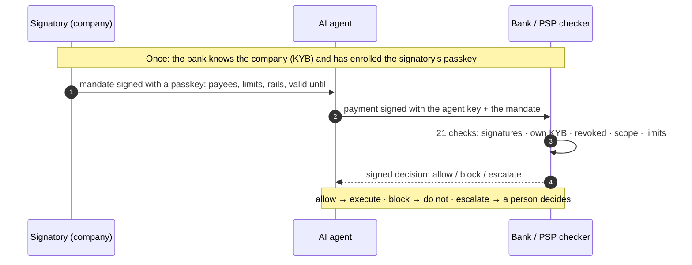

# Gleipnir mandate format, version 0.2 (draft)

Normative draft. A **mandate** is a power of attorney for an AI agent: a person who may sign for a company states what one agent may pay, to whom, how much and until when. A bank or payment service provider (PSP) checks the mandate before it executes a transfer the agent started, and records a signed **decision**.

Gleipnir does not move money and does not verify identities. The bank executes the transfer as it does today; the mandate check is one extra step before execution. Who a person is and what they may sign is established by the bank (KYB) or a qualified vLEI issuer (QVI), once, under their own legal accountability (section 3). After that, every link is a signature.

Encoding, key formats and signature formats are the same as in [format.md](format.md): RFC 8785 (JCS) canonical JSON, SHA-256, Ed25519 or ECDSA P-256, `base64url-nopad`, strict RFC 3339 timestamps, optional fields omitted rather than `null`.

## At a glance



- **Who signs what.** A person who may sign for the company signs the mandate (alone, or several together). The agent signs each payment. The bank signs each decision.
- **Where trust comes from.** Only from the bank's own records (or a vLEI credential), never from the mandate. Keys in a mandate count only if the bank enrolled them for that person.
- **What the bank gets.** One extra, deterministic check before execution, and a receipt it can show anyone later.
- **Conformance.** A Python reference and a TypeScript port pass the same published test vectors (Appendix B).

Changes from 0.1: enrollment (section 3), multi-signature mandates (4.2), delegation chains with aggregate limits (5), idempotency per payer claimed only after authentication and a ledger keyed by hash (7), revocation of delegations and who may revoke (9), receipts (10), a threat model (11), stricter encoding (13), domain-separated passkey challenges (4.3). All `v` strings and signature prefixes move to `0.2`; 0.1 objects are not accepted.

## 1. Objects

| Object | Signed by | Purpose |
|---|---|---|
| `mandate` | one signatory, or a threshold of signatories, of the company | What the agent may pay. |
| `delegation` | a person with authority (or a delegate) | Passes a bounded part of that authority to another person. |
| `revocation` | a person in the line of authority, or any signatory | Switches a mandate or a delegation off. |
| `payment` | the agent (when the mandate names an agent key) | The transfer the agent asks the bank to execute, plus the mandate it relies on. |
| `decision` | the checker (bank, PSP or a hosted checker) | The result of checking one payment against one mandate. |

Every object has `v: "gleipnir/<object>/0.2"` and an `id`.

## 2. Chain of trust

Each link answers "how would a bad actor fake this?" with a signature or a record of an accountable party.

| # | Link | Proven by | Attack it stops |
|---|---|---|---|
| 1 | The company exists | Bank KYB (register extract, LEI) | Made-up company |
| 2 | The person is who they say | Bank onboarding identity check, or a QVI for vLEI | Impersonator by phone or email |
| 3 | The person may sign | Business register (directors, authorised signatories) or vLEI OOR, as recorded by the bank | "I'm the CFO" without powers |
| 4 | Delegation | Signed delegation chain (section 5), or vLEI ECR | "I was allowed" without proof |
| 5 | Signing the mandate | SCA or passkey in the bank's or platform's app (section 3) | Unattended logged-in session |
| 6 | The right agent | Agent key signs every payment | Another agent with a stolen mandate |
| 7 | Payment within scope | Payee, limits, validity, rail, replay (section 7) | Swapped IBAN, extra amount |
| 8 | Still valid | Revocation checked on every payment | Fired, on leave, agent replaced |
| 9 | Receipt | Signed decision plus the whole chain (section 10) | "Prove it" three months later |

Links 1–3 exist at banks today. Links 4–6 are signed by the company. Links 7–9 are the check.

## 3. Enrollment: binding a signer key to a person

A signature only means something if the key belongs to a known person. **Gleipnir does not verify identity.** The bank (or a QVI) does, and the checker learns the result through the authority contract (section 8). There are three ways a signer key gets bound to a person:

**(a) Bank or platform enrollment (default).** After KYB, the bank registers the signatory's key itself: a passkey created in the bank's app, or a key confirmed with the bank's strong customer authentication (SCA, PSD2). The person signs each mandate in that app, with a fresh SCA or passkey gesture over the mandate hash (section 4.3). The bank's KYB record then holds both facts: this person may sign for this company, and these are their keys. A platform (ERP, spend management) can do the same for its users if a bank accepts the platform as an authority source.

**(b) Business register.** A national business register (for example Firmenbuch, Handelsregister, RCS, Registro delle imprese, KvK, KRS or Companies House; across the EU interconnected through BRIS) says **who** may sign and how (alone, or only jointly with others), but holds no keys. A register is therefore never enough on its own: it supplies `may_sign` and `joint`, and path (a) supplies the key. A checker must not accept a key for a register entry unless the bank enrolled that key for that person.

**(c) vLEI.** A GLEIF vLEI Official Organizational Role (OOR) or Engagement Context Role (ECR) credential, issued by a QVI after its own identity check, binds the role and the key in one credential chained to the company's LEI. This is the path for a bank that never onboarded the company (cross-bank, cross-border).

Assurance levels: (a) alone is the light level that covers SMEs at their own bank; (a) with (b) adds register-backed signing powers; (c) is the high level that works across banks. The decision records which source was used (`signer_authorized:<source>`).

## 4. Mandate

```json
{
  "v": "gleipnir/mandate/0.2",
  "id": "m_01JB7K3Q8Z4W2N6F",
  "company": {
    "name": "Nordhafen Logistik GmbH",
    "country": "AT",
    "ids": {"lei": "529900T8BM49AURSDO55", "register": "FN 123456a"}
  },
  "agent": {
    "id": "ap-agent",
    "name": "Accounts payable agent",
    "public_key": "ed25519:…"
  },
  "signer": {
    "id": "kberger@nordhafen.at",
    "name": "K. Berger",
    "role": "Authorised signatory",
    "public_key": "ed25519:…"
  },
  "scope": {
    "rails": ["sepa", "sepa_instant"],
    "currency": "EUR",
    "max_per_payment": "25000.00",
    "max_per_period": {"amount": "100000.00", "period": "P1M"},
    "payees": [
      {"name": "Brenner Stahl AG", "account": {"iban": "AT611904300234573201"}}
    ],
    "purpose": "Supplier invoices"
  },
  "valid_from": "2026-10-23T00:00:00.000Z",
  "valid_until": "2026-12-31T23:59:59.000Z",
  "issued_at": "2026-10-23T09:00:00.000Z",
  "status_url": "https://checker.example.com/v0/mandates/m_01JB7K3Q8Z4W2N6F/status",
  "sig": "ed25519:…"
}
```

### 4.1 Rules

- `company.name` and `company.country` (ISO 3166-1 alpha-2, two uppercase letters) are required. `company.ids` is optional and open: `lei`, `vlei` (a vLEI credential reference), `register`, `vat`, or the bank's own customer id under `bank:<bic>`.
- `agent.id` is required. `agent.public_key` is optional; when present, the payment must carry an agent signature (section 6) so a stolen mandate alone is not enough.
- Exactly one of `signer` (one signatory, signature in `sig`) or `signers` (a threshold, signatures in `sigs`, section 4.2). Each signer has `id` and `public_key`; `role` and `name` are informational. **Whether this person may sign for this company is not decided by the mandate.** The checker decides it from its own source (section 8).
- `scope.currency` is required and applies to every amount in the scope. Amounts are decimal strings with exactly the currency's ISO 4217 minor units, no sign, no exponent, no leading zeros, no whitespace: `^(0|[1-9][0-9]*)\.[0-9]{2}$` for EUR, USD, GBP, CHF, SEK, NOK, DKK, PLN, CZK, HUF; `^(0|[1-9][0-9]*)$` for JPY. Other currencies are not supported in 0.2. Every amount must be greater than zero. Never floats.
- `scope.max_per_payment` is required. `scope.max_per_period` is optional; `period` is one of `P1D` (UTC calendar day), `P7D` (ISO week, Monday to Sunday, UTC) or `P1M` (UTC calendar month).
- `scope.payees` is optional; every entry must have a non-empty `account` object whose fields are all non-empty strings; an `iban` contains only ASCII letters, digits and spaces. If present, a payment is covered only if its payee account matches one entry exactly after normalization (IBAN uppercase without spaces; other account objects compared field by field without spaces). If absent, any payee is allowed within the limits. A changed account is a different payee.
- `scope.rails` is optional; values: `sepa`, `sepa_instant`, `ach`, `wire`, `faster_payments`, `fednow`, `rtp`. If absent, any rail.
- `valid_until` is required. Producers should keep mandates short (weeks or months, not years).
- `status_url` is optional. If present, the checker must fetch the mandate status from it (section 7).
- `delegation` is optional: the chain of delegations the signer's authority comes from (section 5). Only with a single `signer`.
- To change a mandate (new limit, new payee), issue a new one and revoke the old one. Mandates are never edited in place; any edit breaks the signature.

### 4.2 Multi-signature and joint signing

Many companies may only be bound by two (or more) people acting together. Company law across Europe has this rule under local names, for example Gesamtprokura or Gesamtvertretung (Austria, Germany), Kollektivunterschrift zu zweien (Switzerland), signature conjointe (France, Belgium), firma congiunta (Italy), firma mancomunada (Spain), gezamenlijke bevoegdheid (Netherlands), reprezentacja łączna (Poland); US and UK banks know it as dual authorisation. The spec calls it **joint signing** and models it the same way everywhere:

```json
"signers": {
  "threshold": 2,
  "of": [
    {"id": "kberger@nordhafen.at", "role": "Authorised signatory", "public_key": "ed25519:…"},
    {"id": "mhofer@nordhafen.at", "role": "Managing director", "public_key": "ed25519:…"}
  ]
},
"sigs": [
  {"signer": "kberger@nordhafen.at", "sig": "ed25519:…"},
  {"signer": "mhofer@nordhafen.at", "sig": {"type": "webauthn", …}}
]
```

- `threshold` is an integer, 1 ≤ threshold ≤ number of entries in `of`. Signer ids in `of` are unique, and so are their public keys: one key under two ids would let one person count twice.
- Each entry in `sigs` names a signer from `of` (at most one entry per signer) and signs the same message as a single signature (section 4.3).
- Every signature present must be valid; an invalid one blocks the mandate (`mandate_bad_signature`), because a broken co-signature means the object was altered or forged.
- Every signer who signed is checked through the authority contract **separately**. A signer the source rejects blocks the mandate (`signer_not_authorized`). Only signers the source accepts count towards the threshold.
- A source may report that a person can only sign jointly (`joint: n`; "only together with one other" is `joint: 2`). The number of counted signatures must reach the largest `joint` among the counted signers, also when the mandate itself says `threshold: 1` or uses a single `signer`. This stops a person who may only sign jointly from issuing a mandate alone.

### 4.3 Signature

`mandate_hash = "sha256:" || hex(SHA-256(JCS(mandate minus "sig" and "sigs")))`. Each signature is over

    "gleipnir/mandate/v0.2\n" || mandate_hash

in the record signature format of format.md. A signer may also sign with a passkey: the signature is then an object `{"type": "webauthn", …}` exactly as in format.md "Signed approvals", with the WebAuthn challenge set to the 32 raw bytes of `passkey_digest = SHA-256("gleipnir/mandate/v0.2\n" || mandate_hash)`. The domain prefix keeps a mandate passkey signature from ever counting as an approval of an agent action (format.md "Signed approvals" signs the bare action digest), and the reverse. This is how path (a) of section 3 works on a phone: the bank's app shows the mandate, the person confirms with a passkey, and the app adds the signature. Because the hash excludes `sig` and `sigs`, co-signers sign the identical hash in any order.

## 5. Delegation

A person with authority passes a bounded part of it to another person: CEO → CFO → mandate. The chain travels inside the mandate, root first:

```json
"delegation": [
  {
    "v": "gleipnir/delegation/0.2",
    "id": "g_ceo_cfo",
    "company": {"name": "Nordhafen Logistik GmbH", "country": "AT"},
    "from": {"id": "ceo@nordhafen.at", "public_key": "ed25519:…"},
    "to": {"id": "cfo@nordhafen.at", "role": "CFO", "public_key": "ed25519:…"},
    "scope": {"rails": ["sepa"], "currency": "EUR", "max_per_payment": "50000.00",
              "max_per_period": {"amount": "200000.00", "period": "P1M"}},
    "valid_until": "2027-03-31T23:59:59.000Z",
    "issued_at": "2026-10-01T08:00:00.000Z",
    "sig": "ed25519:…"
  }
]
```

A later link names its parent: `"parent": {"id": "g_ceo_cfo", "hash": "sha256:…"}`. `delegation_hash` is computed like `mandate_hash` (minus `sig`); the signature prefix is `"gleipnir/delegation/v0.2\n"`, signed by `from.public_key`. At most 5 links.

The checker verifies, in addition to the mandate steps:

1. **Linkage.** Each link's `from` equals the previous link's `to` (id and key) and its `parent` is the previous link's `id` and hash; the root has no `parent`; every link names the mandate's company (same `name`, and the same `country` and `ids` where the link gives them); the mandate's `signer` equals the last link's `to`. Otherwise `delegation_broken` (block).
2. **Signatures.** Each link is validly signed by its `from` key. Otherwise `delegation_bad_signature` (block).
3. **Authority, per link.** The root's `from` must be a person the source says may sign (with `joint` ≤ 1); every `to` must be a person the source knows with that key (enrolled, section 3), even if they have no signing power of their own. Unknown person: `signer_unknown` (escalate); other key or no power at the root: `signer_not_authorized` (block); root needs a co-signer: `joint_signature_required` (block).
4. **Narrowing.** Each link's scope, and the mandate's scope, must be within its parent's: same currency; amounts not higher; if the parent limits rails, payees or a period, the child limits them at least as much (rails and payees a subset, same period, amount not higher); validity inside the parent's window. Otherwise `scope_exceeds_delegation` (block).
5. **A link's period limit is an aggregate.** It caps the total of all payments under every mandate below that link, not each mandate separately: a CFO delegated 200 000 a month can sign several mandates, but they share the 200 000 (section 7, step 21).
6. **Revocation.** A revocation of any link stops every mandate below it (`delegation_revoked`, block).

## 6. Payment

What the agent submits to the bank, or what the bank's API layer builds from the agent's request:

```json
{
  "v": "gleipnir/payment/0.2",
  "id": "p_7Q-20418",
  "mandate": {"id": "m_01JB7K3Q8Z4W2N6F", "hash": "sha256:…"},
  "rail": "sepa",
  "amount": "18400.00",
  "currency": "EUR",
  "payee": {"name": "Brenner Stahl AG", "account": {"iban": "AT611904300234573201"}},
  "reference": "INV-2026-0912",
  "requested_at": "2026-10-23T09:14:02.000Z",
  "agent_sig": "ed25519:…"
}
```

`id` must be unique per payer (the company): the checker treats a second payment from the same company with the same `id` as a duplicate (section 7, step 13). `rail` is one of the rails in section 4.1, and `payee.account` follows the same rules as a payee on the mandate. `requested_at` is the agent's own clock and is informational; the checker uses its own clock.

`agent_sig` is required when the mandate names `agent.public_key`: a signature over `"gleipnir/payment/v0.2\n" || payment_hash`, where `payment_hash` is computed over the payment minus `agent_sig`.

The full mandate travels with the payment (as a separate field of the API call or a header) or is fetched by id from the issuer; the payment itself only references it by id and hash.

## 7. Check

**Whose clock.** All time-based checks use the checker's own clock ("now"), never a time supplied by the agent. `payment.requested_at` must lie within `max_skew` of now (default 60 seconds), otherwise the payment is blocked with `clock_skew`. Validity, revocation and period limits are evaluated at now.

The checker runs these steps in order and stops at the first failure. Each step yields a reason code.

| # | Check | Fails with | Outcome |
|---|---|---|---|
| **Parse** | | | |
| 1 | Mandate parses: `v` known, required fields present and well-typed, `signer` xor `signers`, well-formed `sigs` and `delegation`, amounts in strict format, known `period`, every payee account well-formed, whole object I-JSON (section 13) | `mandate_malformed` | block |
| 2 | Payment parses: `v` known, `id`, `mandate.id`, `mandate.hash`, a known `rail`, `currency`, well-formed `payee.account`, `requested_at` present and well-typed, amount in strict format and > 0, whole object I-JSON | `payment_malformed` | block |
| 3 | Idempotent retry: if this company already has a final decision for this payment `id` and the same payment hash, return that decision unchanged (read only) | (earlier decision) | |
| **Authenticate** | | | |
| 4 | `payment.mandate.hash` equals the mandate's hash | `mandate_mismatch` | block |
| 5 | `requested_at` within `max_skew` of the checker's clock | `clock_skew` | block |
| 6 | Every mandate signature present is valid for its signer's key (at least one present) | `mandate_bad_signature` | block |
| 7 | Delegation chain, if any, linked and signed (section 5) | `delegation_broken` / `delegation_bad_signature` | block |
| 8 | The authority source (section 8) knows every signer who signed, and every person in the chain | `signer_unknown` | escalate |
| 9 | The source says each signer may sign, and the key used is one it binds to that person | `signer_not_authorized` | block |
| 10 | Enough accepted signers, each key counted once: `threshold` and the largest `joint` | `signature_threshold_not_met` / `joint_signature_required` | block |
| 11 | Mandate scope within the delegation chain (section 5) | `scope_exceeds_delegation` | block |
| 12 | Agent signature valid, if the mandate names an agent key | `agent_bad_signature` | block |
| 13 | Claim `(company, id)` atomically in the payment log. Already claimed (another payment, or one still being checked) | `duplicate_payment` | block |
| **Still valid** | | | |
| 14 | `valid_from ≤ now ≤ valid_until` | `mandate_not_yet_valid` / `mandate_expired` | block |
| 15 | Not revoked: a valid revocation of the mandate or of a delegation link (section 9) with `revoked_at ≤ now`, or `status_url` answering `revoked` | `mandate_revoked` / `delegation_revoked` | block |
| 16 | `status_url`, if present, answers exactly `active` | `status_unavailable` | escalate |
| **In scope** | | | |
| 17 | Rail allowed | `rail_not_allowed` | block |
| 18 | Currency matches | `currency_mismatch` | block |
| 19 | Payee account covered (normalized, exact) | `payee_not_on_mandate` | block |
| 20 | `amount ≤ max_per_payment` | `over_payment_limit` | escalate |
| 21 | The amount is atomically reserved against the mandate's period limit and the period limit of every delegation link above it, all or nothing | `over_period_limit` / `ledger_missing` | escalate |

In steps 8 to 10, a signer the source rejects (step 9) blocks immediately. Unknown signers only matter if the accepted ones are not enough: then the outcome is `signer_unknown` (escalate), because another source may know them. A dependency the checker cannot reach (authority source, payment log, ledger) gives `checker_unavailable` (escalate). Any input the checker cannot process gives a signed `block`; a checker never raises on input and never allows a payment it could not fully check.

Outcomes:

- **allow**: every check passed. The bank executes.
- **block**: the payment is not covered and must not be executed on the strength of this mandate.
- **escalate**: the payment may be legitimate but needs a person (the company or the bank's operations team) before execution.

**Idempotency.** The checker keeps a payment log keyed by payer and payment `id` with the payment hash and the decision. Step 3 only reads it. A payment claims its key only in step 13, after the mandate, the signers' authority and the agent signature are verified, so an unsigned or forged submission can never use up someone else's payment id. Claiming must be atomic, so two concurrent submissions of one key cannot both pass. The log keeps final decisions only: after `checker_unavailable`, `status_unavailable`, `ledger_missing`, `mandate_not_yet_valid` or `over_period_limit` the claim is released, and a retry of the same payment is checked afresh (the dependency may be back, the mandate may have become valid, a new period may have started). The key encodes payer and id unambiguously (JCS of `[country, name, ids, id]`), so no company name can be chosen to collide with another payer's key.

**A cached decision describes the first check.** A resend of the same payment gets the earlier decision back unchanged, even after a later revocation or outside the clock-skew window, because step 3 runs first. That is the point: an allowed payment the bank has already executed must not be executed again, and its record must not change. A bank must therefore treat a returned earlier `allow` as "already decided, execute at most once", never as a fresh authorization.

**Period ledger.** Step 21 uses `reserve(key, period, amount, limit, now) → bool`, which atomically adds the amount to the running total of the current period only if the result stays within the limit, and `release(key, period, amount, now)`. Keys are `mandate:<mandate_hash>` and `delegation:<delegation_hash>`, never a mandate `id` alone (ids are chosen by companies and can collide). The checker reserves against the mandate and every link with a period limit; if one reservation fails it releases the ones it made. A checker without a ledger must not allow payments under a mandate or chain with a period limit (`ledger_missing`). If the bank later does not execute an allowed payment it releases the reservations.

## 8. Who may sign: the authority contract

The mandate states who signed. The checker decides whether that person may sign for the company, using one or more **authority sources** (section 3): the bank's KYB records (default), a company register mapped to enrolled keys, or vLEI role credentials. A checker may ask several sources in order; the first that knows the person answers.

The source is asked about a **person**, never about a key taken from the mandate:

    authority(company, person_id) → {source, keys, may_sign, joint} | unknown

- `keys`: the public keys (or passkey keys) the source itself binds to that person (section 3). A signature made with any other key is `signer_not_authorized`, even if it is valid.
- `may_sign`: the person has signing power of their own (default true). A person known only as a delegate has `may_sign: false`.
- `joint`: how many signatures, including this person's, their signing power requires (default 1; "only together with one other" is 2).

The same contract applies to signers of revocations and to every person in a delegation chain. The decision records the source used. When a person leaves the company, the bank updates its records (`may_sign: false` or unknown) and every mandate they signed stops at the next payment, with or without a revocation.

## 9. Revocation

```json
{
  "v": "gleipnir/revocation/0.2",
  "id": "r_01JB8…",
  "mandate": "m_01JB7K3Q8Z4W2N6F",
  "mandate_hash": "sha256:…",
  "revoked_at": "2026-11-02T10:42:00.000Z",
  "signer": {"id": "mhofer@nordhafen.at", "public_key": "ed25519:…"},
  "reason": "Agent replaced",
  "sig": "ed25519:…"
}
```

A revocation of a delegation link names `"delegation"` and `"delegation_hash"` instead of `"mandate"` and `"mandate_hash"`. Signed with the prefix `"gleipnir/revocation/v0.2\n"`. It takes effect at `revoked_at`; a payment checked at or after that time is blocked.

Who may revoke: a person the authority source knows with that key, who either may sign for the company, or is in the line of authority of the target. For a mandate, that is its signers and everyone in its delegation chain. For a delegation link, it is the `from` and `to` of that link and of the links above it, never a delegate further down. So a CEO can cut a delegation, a CFO can withdraw their own mandate or hand back their own delegation even without signing power of their own, and a controller below the CFO cannot cut the CEO's delegation to the CFO. Anyone else's revocation is ignored.

## 10. Decision and receipt

```json
{
  "v": "gleipnir/decision/0.2",
  "id": "d_01JB7…",
  "payment": {"id": "p_7Q-20418", "hash": "sha256:…"},
  "mandate": {"id": "m_01JB7K3Q8Z4W2N6F", "hash": "sha256:…"},
  "outcome": "allow",
  "reasons": [],
  "checks": ["mandate_valid", "signer_authorized:bank_kyb", "agent_signed", "not_revoked", "payee_on_mandate", "within_payment_limit", "within_period_limit"],
  "checked_at": "2026-10-23T09:14:02.312Z",
  "checker": {"id": "bank:RZBAATWW", "public_key": "ed25519:…"},
  "sig": "ed25519:…"
}
```

Signed by the checker with the prefix `"gleipnir/decision/v0.2\n"`. `checked_at` is the checker's clock. A decision is verified against the bank's **known** checker keys, obtained out of band (for example from the bank's published key list); the `checker.public_key` inside the decision only says which of those keys signed it and is never trusted on its own. `id` is random. With multi-signature, `checks` lists `signer_authorized:<source>` per counted signer and `signatures:<n>/<needed>`; with delegation, `delegation:<links>`.

**Receipt.** Mandate + payment + decision form a receipt anyone can check offline, months later, without the bank or Gleipnir: the decision is signed by a known bank key; it names exactly this mandate and payment by hash; every mandate signature, every delegation link and the agent signature are valid. The receipt shows who authorized the payment (signers and chain), which source the bank relied on, and what the bank decided and when. Decisions may be appended to a hash-chained log in the record format of format.md (`kind: "note"` with `note.decision`), so the company, the bank and an auditor can show what was checked and when.

## 11. Threat model

| Link | Attack | Closed by |
|---|---|---|
| 1 Company | Made-up company, or a mandate naming a company the signer does not belong to | Authority is asked per company; the bank only knows companies it onboarded (KYB) |
| 2 Person | Impersonator by phone or email claims to be the CFO | Gleipnir never accepts a claim: keys come from the bank's enrollment or a vLEI credential (section 3) |
| 3 Power to sign | "I'm the CFO" without powers; a joint signatory acting alone | `may_sign` and `joint` from the source (`signer_not_authorized`, `joint_signature_required`) |
| 3 Power to sign | One person listed twice to meet a threshold | Keys counted once; duplicate keys in `signers.of` are malformed |
| 4 Delegation | "I was allowed"; a delegate widens their scope; a forged middle link | Signed chain, per-link authority, narrowing rule, linkage by id and hash (`delegation_*`, `scope_exceeds_delegation`) |
| 4 Delegation | A delegate signs many mandates to multiply a delegated monthly limit | A link's period limit is shared by everything below it (`over_period_limit`) |
| 5 Signing | Unattended logged-in session; malware edits the mandate before signing | Per-mandate SCA or passkey over the exact hash; any edit changes the hash (`mandate_bad_signature`) |
| 5 Signing | Mandate signed with an attacker's own key | Key must be one the source binds to the person (`signer_not_authorized`) |
| 6 Agent | Another agent, or a thief, uses a copied mandate | Agent key signs every payment (`agent_bad_signature`) |
| 7 Scope | Swapped IBAN ("we changed our bank details") | Payee list, normalized exact match (`payee_not_on_mandate`) |
| 7 Scope | Inflated or split amounts | Per-payment limit, atomic period ledger (`over_payment_limit`, `over_period_limit`) |
| 7 Scope | Replay of an allowed payment | Payment log by id and hash (`duplicate_payment`, idempotent retry) |
| 7 Scope | Burning a payment id with an unsigned or forged submission; a transient outage cached as the answer | Log keyed by payer and id, claimed only after signatures and authority verify; transient outcomes never cached (section 7) |
| 7 Scope | Another company's mandate with the same id eats this company's monthly limit | Ledger keyed by mandate hash, not id |
| 7 Scope | Wrong rail, currency | `rail_not_allowed`, `currency_mismatch` |
| 7 Scope | Agent fakes its clock to use an expired mandate or a past period | Checker clock only (`clock_skew`) |
| 8 Validity | Fired CFO, agent replaced | Revocation per payment; bank removes the person from KYB; one revocation cuts a whole delegation subtree |
| 8 Validity | Status service down to hide a revocation | Never allow without an answer (`status_unavailable`, escalate) |
| 9 Receipt | Bank or company edits the decision later; a fake decision | Decision signed by a known bank key; hashes bind mandate and payment (section 10) |
| all | Dependency down, malformed or hostile input | Signed block or escalate, never allow; never raise |

Residual risks:

- **Compromised signer device.** An attacker with the CFO's unlocked phone and passkey can sign a mandate. Bounded by scope (payees, limits, short validity), visible in the receipt, cut by one revocation. Banks can require a second signer above a threshold (section 4.2).
- **Insider collusion.** Two real signatories can sign a bad mandate together. Not prevented; it is visible and attributable in the receipt, and the liability is the company's.
- **Fake invoice from a real payee.** A genuine payee on the list can still be paid for a fake invoice within the limits. Not solved by mandates; the payee list removes the common "new bank details" fraud.
- **Wrong source data.** If the bank's KYB is wrong or stale, the check is wrong. The bank owns its KYB; the decision records which source was used.
- **Checker key compromise.** Anyone with the bank's checker key can sign decisions. Keys belong in an HSM; banks publish and rotate their key list.
- **Revocation lag.** A revocation the checker has not received yet does not stop a payment. `status_url` closes this for checkers that must be current.

## 12. What this does and does not prove

Proves: named people, accepted by a stated source, signed (or delegated) this scope for this agent; this payment was inside the scope at the time it was checked; the decision was not changed afterwards.

Does not prove: that the agent understood the invoice, that the invoice is genuine, or that the signers chose wisely. A mandate narrows what can go wrong; it does not replace the bank's fraud and AML controls.

## 13. Encoding rules

Objects are I-JSON (RFC 7493) with one tightening: no duplicate keys, no floats at all (`2.0` is refused, not read as `2`), integers within ±(2^53 − 1). A checker parsing JSON from the wire must reject duplicate keys, floats and large integers before hashing, because parsers differ on them and two checkers must never see different objects behind one hash (the TypeScript library's `parseStrict` does this; the Python checker also refuses floats and large integers in the objects it is given). Account fields are strings, IBANs ASCII. Strings should be NFC.

## 14. Open questions for 0.3

- Joint signing inside delegation links (two joint signatories delegating together).
- A standard `status_url` response and a revocation list format for offline checkers.
- Mapping to ISO 20022 `pain.001` fields so the mandate reference travels inside the payment message.
- vLEI credential presentation format inside `company.ids.vlei` and `signer` (ACDC / W3C VC), and how a checker resolves it to an `authority` answer.

## Appendix A. Reason codes

| Code | Outcome | Step | Meaning |
|---|---|---|---|
| `mandate_malformed` | block | 1 | The mandate is not a well-formed 0.2 mandate. |
| `payment_malformed` | block | 2 | The payment is not well formed (or could not be processed at all). |
| `mandate_mismatch` | block | 4 | The payment names a different mandate (hash). |
| `clock_skew` | block | 5 | `requested_at` is too far from the checker's clock. |
| `mandate_bad_signature` | block | 6 | A mandate signature is missing or invalid. |
| `delegation_broken` | block | 7 | The chain does not link up, or names another company. |
| `delegation_bad_signature` | block | 7 | A delegation link is not validly signed. |
| `signer_unknown` | escalate | 8 | No authority source knows a signer (another source might). |
| `signer_not_authorized` | block | 9 | The source says this person may not sign, or not with this key. |
| `signature_threshold_not_met` | block | 10 | Fewer accepted signatures than the mandate's threshold. |
| `joint_signature_required` | block | 10 | A signer's power requires more co-signers (joint signing). |
| `scope_exceeds_delegation` | block | 11 | The mandate or a link is wider than the authority it comes from. |
| `agent_bad_signature` | block | 12 | The payment is not signed by the mandate's agent key. |
| `duplicate_payment` | block | 13 | This company already used this payment id for another payment. |
| `mandate_not_yet_valid` | block | 14 | Before `valid_from` (not cached: a later retry is checked afresh). |
| `mandate_expired` | block | 14 | After `valid_until`. |
| `mandate_revoked` | block | 15 | Revoked by an allowed person, or `status_url` says revoked. |
| `delegation_revoked` | block | 15 | A link in the chain was revoked. |
| `status_unavailable` | escalate | 16 | The status service did not answer `active` (not cached). |
| `rail_not_allowed` | block | 17 | Rail not on the mandate. |
| `currency_mismatch` | block | 18 | Currency differs from the mandate's. |
| `payee_not_on_mandate` | block | 19 | The payee account is not on the mandate. |
| `over_payment_limit` | escalate | 20 | Above `max_per_payment`. |
| `over_period_limit` | escalate | 21 | Above a period limit of the mandate or of a link (not cached). |
| `ledger_missing` | escalate | 21 | A period limit applies but the checker has no ledger (not cached). |
| `checker_unavailable` | escalate | any | A dependency (authority, payment log, ledger) failed (not cached). |

## Appendix B. Conformance

A conforming checker produces, for the same inputs and clock, the same `outcome`, `reasons`, `checks`, hashes and `checked_at` as the reference. Decision `id` and signature bytes may differ.

- Test vectors: `typescript/packages/verify/test/fixtures/mandate-vectors.json` (generated by `python/gleipnir-verify/tests/mandate_vectors.py` from fixed test keys and clocks): each case gives the inputs (mandates, payments, authority answers, revocations, status, ledger, passkey settings) and the expected decisions and receipt, plus payment-log keys. It includes multi-signature, joint signing, delegation, cross-bank vLEI, real ES256 passkey assertions and the inputs found in the 23.10.2026 audits.
- Reference implementations: Python `gleipnir_verify.mandate`, TypeScript `@getgleipnir/verify/mandate`. Both run every vector and verify each other's decisions.

