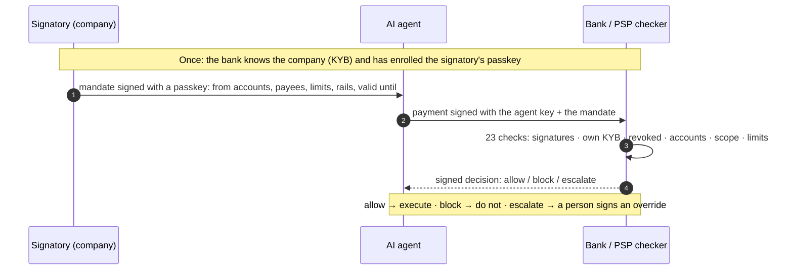

# Gleipnir mandate format, version 0.3 (draft)

Normative draft. A **mandate** is a power of attorney for an AI agent: a person who may sign for a company states what one agent may pay, from which of the company's accounts, to whom, how much and until when. A bank or payment service provider (PSP) checks the mandate before it executes a transfer the agent started, and records a signed **decision**.

Gleipnir does not move money and does not verify identities. The bank executes the transfer as it does today; the mandate check is one extra step before execution. Who a person is and what they may sign is established by the bank (KYB) or a qualified vLEI issuer (QVI), once, under their own legal accountability (section 3). After that, every link is a signature.

Encoding, key formats and signature formats are the same as in [format.md](format.md): RFC 8785 (JCS) canonical JSON, SHA-256, Ed25519 or ECDSA P-256, `base64url-nopad`, strict RFC 3339 timestamps, optional fields omitted rather than `null`.

## At a glance



- **Who signs what.** A person who may sign for the company signs the mandate (alone, or several together). The agent signs each payment. The bank signs each decision. A person, or a bank officer, signs an override when a payment needs one.
- **Where trust comes from.** Only from the bank's own records (or a vLEI credential), never from the mandate. Keys in a mandate count only if the bank enrolled them for that person. The debtor account counts only if the bank holds it for that company.
- **What the bank gets.** One extra, deterministic check before execution, and a receipt it can show anyone later.
- **Conformance.** A Python reference and a TypeScript port pass the same published test vectors (Appendix B).

Changes from 0.2:

- **Debtor accounts** (`scope.from_accounts`, `payment.from_account`, step 7). A mandate names the accounts it may pay from, and works only at the bank that holds them. Ledgers, revocations and replays are per bank by construction.
- **Accounts worldwide** (section 6.1). Typed account schemes with check digits: IBAN, US ABA, UK sort code, Canada, Australia BSB, India IFSC, Mexico CLABE, SWIFT. A rail-to-scheme table (`rail_mismatch`).
- **Overrides** (section 7.1). A signed object resolves an escalation. A bank officer, or the company's own signatories for limit escalations, approve or refuse, and the bank re-checks.
- **Signed status** (section 9.1). `status_url` returns a signed, timed statement bound to the mandate hash, https only.
- **Corrected payments.** A block releases the payment id; allow and pending escalations hold it.
- **Key rotation** (section 8). Retired keys are accepted for objects issued before retirement.
- **Payee policy.** A checker may require a payee list (`payees_required`).
- **Joint revocation.** One joint signatory may revoke alone (section 9).
- **Cached decisions for authentic payments only.** All signatures are verified before a cached decision is returned (step 8).
- **Per-customer payment ids.** The payment log is keyed by the bank's own customer id for the debtor account, so two mandates of one customer share one id space.
- **Decisions record whom they counted** (`signers`, and `approvers` on overrides), so a receipt cannot be relabeled.
- **Limits.** Nesting depth 32, at most 16 signers per mandate and 16 signatures per override.

All `v` strings and signature prefixes move to `0.3`; 0.2 objects are not accepted.

## 1. Objects

| Object | Signed by | Purpose |
|---|---|---|
| `mandate` | one signatory, or a threshold of signatories, of the company | What the agent may pay. |
| `delegation` | a person with authority (or a delegate) | Passes a bounded part of that authority to another person. |
| `revocation` | a person in the line of authority, or any signatory | Switches a mandate or a delegation off. |
| `status` | a person in the line of authority, or any signatory | What `status_url` answers: this mandate is active or revoked, now. |
| `payment` | the agent (when the mandate names an agent key) | The transfer the agent asks the bank to execute, plus the mandate it relies on. |
| `decision` | the checker (bank, PSP or a hosted checker) | The result of checking one payment against one mandate. |
| `override` | a bank officer, or the company's signatories | Resolves an escalation: allow or block this payment. |

Every object has `v: "gleipnir/<object>/0.3"` and, except `status`, an `id`.

## 2. Chain of trust

Each link answers "how would a bad actor fake this?" with a signature or a record of an accountable party.

| # | Link | Proven by | Attack it stops |
|---|---|---|---|
| 1 | The company exists | Bank KYB (register extract, LEI) | Made-up company |
| 2 | The person is who they say | Bank onboarding identity check, or a QVI for vLEI | Impersonator by phone or email |
| 3 | The person may sign | Business register (directors, authorised signatories) or vLEI OOR, as recorded by the bank | "I'm the CFO" without powers |
| 4 | Delegation | Signed delegation chain (section 5), or vLEI ECR | "I was allowed" without proof |
| 5 | Signing the mandate | SCA or passkey in the bank's or platform's app (section 3) | Unattended logged-in session |
| 6 | The right agent | Agent key signs every payment | Another agent with a stolen mandate |
| 7 | Payment within scope | Debtor account, payee, limits, validity, rail, replay (section 7) | Swapped IBAN, extra amount, another company's account |
| 8 | Still valid | Revocation and signed status checked on every payment | Fired, on leave, agent replaced |
| 9 | Receipt | Signed decision plus the whole chain, and any override (section 10) | "Prove it" three months later |

Links 1–3 exist at banks today. Links 4–6 are signed by the company. Links 7–9 are the check.

## 3. Enrollment: binding a signer key to a person

A signature only means something if the key belongs to a known person. **Gleipnir does not verify identity.** The bank (or a QVI) does, and the checker learns the result through the authority contract (section 8). There are three ways a signer key gets bound to a person:

**(a) Bank or platform enrollment (default).** After KYB, the bank registers the signatory's key itself: a passkey created in the bank's app, or a key confirmed with the bank's strong customer authentication (SCA, PSD2). The person signs each mandate in that app, with a fresh SCA or passkey gesture over the mandate hash (section 4.3). The bank's KYB record then holds both facts: this person may sign for this company, and these are their keys. A platform (ERP, spend management) can do the same for its users if a bank accepts the platform as an authority source.

**(b) Business register.** A national business register (for example Firmenbuch, Handelsregister, RCS, Registro delle imprese, KvK, KRS or Companies House; across the EU interconnected through BRIS) says **who** may sign and how (alone, or only jointly with others), but holds no keys. A register is therefore never enough on its own: it supplies `may_sign` and `joint`, and path (a) supplies the key. A checker must not accept a key for a register entry unless the bank enrolled that key for that person.

**(c) vLEI.** A GLEIF vLEI Official Organizational Role (OOR) or Engagement Context Role (ECR) credential, issued by a QVI after its own identity check, binds the role and the key in one credential chained to the company's LEI. This is the path for a bank that holds the company's account but never verified its signatories itself.

Assurance levels: (a) alone is the light level that covers SMEs at their own bank; (a) with (b) adds register-backed signing powers; (c) is the high level that works across banks. The decision records which source was used (`signer_authorized:<source>`).

## 4. Mandate

```json
{
  "v": "gleipnir/mandate/0.3",
  "id": "m_01JB7K3Q8Z4W2N6F",
  "company": {
    "name": "Nordhafen Logistik GmbH",
    "country": "AT",
    "ids": {"lei": "529900T8BM49AURSDO55", "register": "FN 123456a"}
  },
  "agent": {
    "id": "ap-agent",
    "name": "Accounts payable agent",
    "public_key": "ed25519:…"
  },
  "signer": {
    "id": "kberger@nordhafen.at",
    "name": "K. Berger",
    "role": "Authorised signatory",
    "public_key": "ed25519:…"
  },
  "scope": {
    "from_accounts": [{"scheme": "iban", "iban": "AT483200000012345864"}],
    "rails": ["sepa", "sepa_instant"],
    "currency": "EUR",
    "max_per_payment": "25000.00",
    "max_per_period": {"amount": "100000.00", "period": "P1M"},
    "payees": [
      {"name": "Brenner Stahl AG", "account": {"scheme": "iban", "iban": "AT611904300234573201"}}
    ],
    "purpose": "Supplier invoices"
  },
  "valid_from": "2026-10-23T00:00:00.000Z",
  "valid_until": "2026-12-31T23:59:59.000Z",
  "issued_at": "2026-10-23T09:00:00.000Z",
  "status_url": "https://status.nordhafen.at/mandates/m_01JB7K3Q8Z4W2N6F",
  "sig": "ed25519:…"
}
```

### 4.1 Rules

- `company.name` and `company.country` (ISO 3166-1 alpha-2, two uppercase letters) are required. `company.ids` is optional and open: `lei`, `vlei` (a vLEI credential reference), `register`, `vat`, or the bank's own customer id under `bank:<bic>`.
- `agent.id` is required. `agent.public_key` is optional; when present, the payment must carry an agent signature (section 6) so a stolen mandate alone is not enough.
- Exactly one of `signer` (one signatory, signature in `sig`) or `signers` (a threshold, signatures in `sigs`, section 4.2). Each signer has `id` and `public_key`; `role` and `name` are informational. **Whether this person may sign for this company is not decided by the mandate.** The checker decides it from its own source (section 8).
- `scope.from_accounts` is required: a non-empty list of the company's own accounts (section 6.1) the agent may pay from, no account twice. The bank checks that the company holds each one it is asked to debit (step 7), so a mandate cannot be used on someone else's account, nor at a bank that does not hold the account.
- `scope.currency` is required and applies to every amount in the scope. Amounts are decimal strings with exactly the currency's ISO 4217 minor units, no sign, no exponent, no leading zeros, no whitespace: `^(0|[1-9][0-9]*)\.[0-9]{2}$` for EUR, USD, GBP, CHF, SEK, NOK, DKK, PLN, CZK, HUF, RON, CAD, AUD, NZD, SGD, HKD, INR, MXN; `^(0|[1-9][0-9]*)$` for JPY. Other currencies are not supported in 0.3. Every amount must be greater than zero. Never floats.
- `scope.max_per_payment` is required. `scope.max_per_period` is optional; `period` is one of `P1D` (UTC calendar day), `P7D` (ISO week, Monday to Sunday, UTC) or `P1M` (UTC calendar month). A period limit is enforced by one bank's ledger, so every account in `from_accounts` of a period-limited mandate must be held by the checking bank (step 7); a company that pays from several banks issues one mandate per bank.
- `scope.payees` is optional but **recommended**: a non-empty list of `{name, account}`, no account twice. If present, a payment is covered only if its payee account equals one entry exactly (section 6.1: accounts are canonical, so equality is byte equality of their JCS encoding). A changed account is a different payee. If absent, any payee is allowed within the limits; a checker may refuse such mandates by policy (`payees_required`), and should for agents that pay invoices, since "we changed our bank details" is the common fraud.
- `scope.rails` is optional; values from the rail table in section 6.1. If absent, any rail.
- `valid_until` and `issued_at` are required. Producers should keep mandates short (weeks or months, not years).
- `status_url` is optional: an `https://` URL, ASCII, at most 2048 characters. If present, the checker must get a valid signed status for every payment (section 9.1).
- `delegation` is optional: the chain of delegations the signer's authority comes from (section 5). Only with a single `signer`.
- To change a mandate (new limit, new payee), issue a new one and revoke the old one. Mandates are never edited in place; any edit breaks the signature.

### 4.2 Multi-signature and joint signing

Many companies may only be bound by two (or more) people acting together. Company law across Europe has this rule under local names, for example Gesamtprokura or Gesamtvertretung (Austria, Germany), Kollektivunterschrift zu zweien (Switzerland), signature conjointe (France, Belgium), firma congiunta (Italy), firma mancomunada (Spain), gezamenlijke bevoegdheid (Netherlands), reprezentacja łączna (Poland); US and UK banks know it as dual authorisation. The spec calls it **joint signing** and models it the same way everywhere:

```json
"signers": {
  "threshold": 2,
  "of": [
    {"id": "kberger@nordhafen.at", "role": "Authorised signatory", "public_key": "ed25519:…"},
    {"id": "mhofer@nordhafen.at", "role": "Managing director", "public_key": "ed25519:…"}
  ]
},
"sigs": [
  {"signer": "kberger@nordhafen.at", "sig": "ed25519:…"},
  {"signer": "mhofer@nordhafen.at", "sig": {"type": "webauthn", …}}
]
```

- `threshold` is an integer, 1 ≤ threshold ≤ number of entries in `of`, and `of` has at most 16 entries. Signer ids in `of` are unique, and so are their public keys: one key under two ids would let one person count twice. Where one person is known under several ids or keys, the authority source says so (`person`, section 8) and they count once.
- Each entry in `sigs` names a signer from `of` (at most one entry per signer) and signs the same message as a single signature (section 4.3).
- Every signature present must be valid; an invalid one blocks the mandate (`mandate_bad_signature`), because a broken co-signature means the object was altered or forged.
- Every signer who signed is checked through the authority contract **separately**. A signer the source rejects blocks the mandate (`signer_not_authorized`). Only signers the source accepts count towards the threshold. Because `sigs` are outside the hash, a holder of the mandate can drop a signature; what counts is the set of signatures presented, and the decision records exactly whom the bank counted (`signers`, section 10), so the receipt shows it.
- A source may report that a person can only sign jointly (`joint: n`; "only together with one other" is `joint: 2`). The number of counted signatures must reach the largest `joint` among the counted signers, also when the mandate itself says `threshold: 1` or uses a single `signer`. This stops a person who may only sign jointly from issuing a mandate alone.
- Switching off needs no co-signer: any one signer of a jointly signed mandate may revoke it alone (section 9). Approving more than the mandate allows does need the co-signers (section 7.1).

### 4.3 Signature

`mandate_hash = "sha256:" || hex(SHA-256(JCS(mandate minus "sig" and "sigs")))`. Each signature is over

    "gleipnir/mandate/v0.3\n" || mandate_hash

in the record signature format of format.md. A signer may also sign with a passkey: the signature is then an object `{"type": "webauthn", …}` exactly as in format.md "Signed approvals", with the WebAuthn challenge set to the 32 raw bytes of `passkey_digest = SHA-256("gleipnir/mandate/v0.3\n" || mandate_hash)`. The domain prefix keeps a mandate passkey signature from ever counting as an approval of an agent action (format.md "Signed approvals" signs the bare action digest), and the reverse. This is how path (a) of section 3 works on a phone: the bank's app shows the mandate, the person confirms with a passkey, and the app adds the signature. Because the hash excludes `sig` and `sigs`, co-signers sign the identical hash in any order.

## 5. Delegation

A person with authority passes a bounded part of it to another person: CEO → CFO → mandate. The chain travels inside the mandate, root first:

```json
"delegation": [
  {
    "v": "gleipnir/delegation/0.3",
    "id": "g_ceo_cfo",
    "company": {"name": "Nordhafen Logistik GmbH", "country": "AT"},
    "from": {"id": "ceo@nordhafen.at", "public_key": "ed25519:…"},
    "to": {"id": "cfo@nordhafen.at", "role": "CFO", "public_key": "ed25519:…"},
    "scope": {"rails": ["sepa"], "currency": "EUR", "max_per_payment": "50000.00",
              "max_per_period": {"amount": "200000.00", "period": "P1M"},
              "from_accounts": [{"scheme": "iban", "iban": "AT483200000012345864"}]},
    "valid_until": "2027-03-31T23:59:59.000Z",
    "issued_at": "2026-10-01T08:00:00.000Z",
    "sig": "ed25519:…"
  }
]
```

A later link names its parent: `"parent": {"id": "g_ceo_cfo", "hash": "sha256:…"}`. `delegation_hash` is computed like `mandate_hash` (minus `sig`); the signature prefix is `"gleipnir/delegation/v0.3\n"`, signed by `from.public_key`. At most 5 links. `issued_at` is required. In a link, `scope.from_accounts` is optional, but required with a period limit (a link's limit is kept by one bank's ledger, like a mandate's).

The checker verifies, in addition to the mandate steps:

1. **Linkage.** Each link's `from` equals the previous link's `to` (id and key) and its `parent` is the previous link's `id` and hash; the root has no `parent`; every link names the mandate's company (same `name`, and the same `country` and `ids` where the link gives them); the mandate's `signer` equals the last link's `to`. Otherwise `delegation_broken` (block).
2. **Signatures.** Each link is validly signed by its `from` key. Otherwise `delegation_bad_signature` (block).
3. **Authority, per link.** The root's `from` must be a person the source says may sign (with `joint` ≤ 1); every `to` must be a person the source knows with that key (enrolled, section 3), even if they have no signing power of their own. Unknown person: `signer_unknown` (escalate); other key or no power at the root: `signer_not_authorized` (block); root needs a co-signer: `joint_signature_required` (block).
4. **Narrowing.** Each link's scope, and the mandate's scope, must be within its parent's: same currency; amounts not higher; if the parent limits rails, payees, debtor accounts or a period, the child limits them at least as much (rails, payees and `from_accounts` a subset, same period, amount not higher); validity inside the parent's window. Otherwise `scope_exceeds_delegation` (block).
5. **A link's period limit is an aggregate.** It caps the total of all payments under every mandate below that link, not each mandate separately: a CFO delegated 200 000 a month can sign several mandates, but they share the 200 000 (section 7, step 23).
6. **Revocation.** A revocation of any link stops every mandate below it (`delegation_revoked`, block).

## 6. Payment

What the agent submits to the bank, or what the bank's API layer builds from the agent's request:

```json
{
  "v": "gleipnir/payment/0.3",
  "id": "p_7Q-20418",
  "mandate": {"id": "m_01JB7K3Q8Z4W2N6F", "hash": "sha256:…"},
  "rail": "sepa",
  "amount": "18400.00",
  "currency": "EUR",
  "from_account": {"scheme": "iban", "iban": "AT483200000012345864"},
  "payee": {"name": "Brenner Stahl AG", "account": {"scheme": "iban", "iban": "AT611904300234573201"}},
  "reference": "INV-2026-0912",
  "requested_at": "2026-10-23T09:14:02.000Z",
  "agent_sig": "ed25519:…"
}
```

`id` must be unique per payer (the company): the checker treats a second payment from the same company with the same `id` as a duplicate while the first holds it (section 7, step 14). `rail` is one of the rails in section 6.1. `from_account` is the company's account to debit; it must be one of the mandate's `from_accounts`. `payee.account` is the creditor account. `requested_at` is the agent's own clock and is informational; the checker uses its own clock.

`agent_sig` is required when the mandate names `agent.public_key`: a signature over `"gleipnir/payment/v0.3\n" || payment_hash`, where `payment_hash` is computed over the payment minus `agent_sig`.

The full mandate travels with the payment (as a separate field of the API call or a header) or is fetched by id from the issuer; the payment itself only references it by id and hash.

### 6.1 Accounts and rails

Bank transfers are addressed by account identifiers, not card numbers, and those differ by country. IBAN covers Europe (all of SEPA), much of the Middle East and some of Africa and Latin America; the United States, Canada, Australia, India and Mexico use their own domestic identifiers; the UK has IBANs but pays domestically by sort code and account number; international wires address the beneficiary's bank by BIC. An account is an object with a `scheme` and exactly that scheme's fields:

| `scheme` | Fields (canonical form) | Check |
|---|---|---|
| `iban` | `iban`: `^[A-Z]{2}[0-9]{2}[A-Z0-9]{11,30}$` | ISO 13616 mod-97 = 1 |
| `us_aba` | `routing`: 9 digits; `account`: 1–17 digits | ABA check digit (weights 3, 7, 1) |
| `uk_sort_code` | `sort_code`: 6 digits; `account`: 8 digits | |
| `ca_eft` | `institution`: 3 digits; `transit`: 5 digits; `account`: 7–12 digits | |
| `au_bsb` | `bsb`: 6 digits; `account`: 5–10 digits | |
| `in_ifsc` | `ifsc`: `^[A-Z]{4}0[A-Z0-9]{6}$`; `account`: 9–18 digits | |
| `mx_clabe` | `clabe`: 18 digits | CLABE check digit (weights 3, 7, 1) |
| `swift` | `bic`: `^[A-Z]{6}[A-Z0-9]{2}([A-Z0-9]{3})?$`; `account`: `^[A-Z0-9]{1,34}$` | |

Accounts on the wire are **canonical**: ASCII, uppercase, no spaces, hyphens or other separators, no extra fields. A checker never normalizes; it refuses anything else as malformed, and compares accounts by exact equality. Producers (the bank app, the CLI, the agent tool) normalize human input ("AT61 1904 3002 3457 3201", "60-16-13") before signing. Where an account has an IBAN, use the `iban` scheme. A wrong check digit is malformed, so a typo is caught before anyone signs.

Each rail carries one currency between accounts of certain schemes. A payment whose rail cannot carry its currency, or its debtor or payee account scheme, is blocked (`rail_mismatch`, step 19):

| Rail | Account schemes | Currency |
|---|---|---|
| `sepa`, `sepa_instant` | `iban` | EUR |
| `ach`, `fednow`, `rtp` | `us_aba` | USD |
| `faster_payments`, `bacs`, `chaps` | `uk_sort_code` | GBP |
| `ca_eft` | `ca_eft` | CAD |
| `npp`, `becs` | `au_bsb` | AUD |
| `neft`, `rtgs`, `imps` | `in_ifsc` | INR |
| `spei` | `mx_clabe` | MXN |
| `wire` | any | any |

The bank's own rules still apply on top (for example whether an IBAN's country is in the SEPA scheme); the table is the minimum every checker enforces.

## 7. Check

**Whose clock.** All time-based checks use the checker's own clock ("now"), never a time supplied by the agent. `payment.requested_at` must lie within `max_skew` of now (default 60 seconds), otherwise the payment is blocked with `clock_skew`. Validity, revocation, status and period limits are evaluated at now.

The checker runs these steps in order and stops at the first failure. Each step yields a reason code.

| # | Check | Fails with | Outcome |
|---|---|---|---|
| **Parse** | | | |
| 1 | Mandate parses: `v` known, required fields present and well-typed, `signer` xor `signers`, well-formed `sigs` and `delegation`, amounts in strict format, known `period`, every account canonical and of a known scheme, `status_url` https, whole object I-JSON (section 13) | `mandate_malformed` | block |
| 2 | Payment parses: `v` known, `id`, `mandate.id`, `mandate.hash`, a known `rail`, `currency`, canonical `from_account` and `payee.account`, `requested_at` well-typed, amount in strict format and > 0, whole object I-JSON | `payment_malformed` | block |
| **Authentic** | | | |
| 3 | `payment.mandate.hash` equals the mandate's hash | `mandate_mismatch` | block |
| 4 | Every mandate signature present is valid for its signer's key (at least one present) | `mandate_bad_signature` | block |
| 5 | Delegation chain, if any, linked and signed (section 5) | `delegation_broken` / `delegation_bad_signature` | block |
| 6 | Agent signature valid, if the mandate names an agent key | `agent_bad_signature` | block |
| 7 | `from_account` is in `from_accounts`, and the bank holds it for this company: `holds` answers the bank's customer id. With a period limit (of the mandate or a link), the bank holds every account that object lists, for the same customer | `account_not_on_mandate` / `account_not_held` | block |
| 8 | Idempotent retry: if this customer's payment log holds a decision for this payment `id` and the same payment hash, return that decision unchanged (read only) | (earlier decision) | |
| 9 | `requested_at` within `max_skew` of the checker's clock | `clock_skew` | block |
| **Authorized** | | | |
| 10 | The authority source (section 8) knows every signer who signed, and every person in the chain | `signer_unknown` | escalate |
| 11 | The source says each signer may sign, and the key used is one it binds to that person | `signer_not_authorized` | block |
| 12 | Enough accepted signers, each person counted once: `threshold` and the largest `joint` | `signature_threshold_not_met` / `joint_signature_required` | block |
| 13 | Mandate scope within the delegation chain (section 5) | `scope_exceeds_delegation` | block |
| 14 | Claim `(customer, id)` atomically in the payment log. Already claimed (another payment, or one still being checked or waiting for a person) | `duplicate_payment` | block |
| **Still valid** | | | |
| 15 | `valid_from ≤ now ≤ valid_until` | `mandate_not_yet_valid` / `mandate_expired` | block |
| 16 | Not revoked: a valid revocation of the mandate or of a delegation link (section 9) with `revoked_at ≤ now` | `mandate_revoked` / `delegation_revoked` | block |
| 17 | `status_url`, if present: a valid signed status (section 9.1). `revoked` blocks | `mandate_revoked` / `status_unavailable` | block / escalate |
| **In scope** | | | |
| 18 | Rail allowed | `rail_not_allowed` | block |
| 19 | The rail carries the currency and both account schemes (section 6.1) | `rail_mismatch` | block |
| 20 | Currency matches | `currency_mismatch` | block |
| 21 | Payee account on the mandate (exact); without a payee list, the checker's policy may refuse | `payee_not_on_mandate` / `payees_required` | block |
| 22 | `amount ≤ max_per_payment` | `over_payment_limit` | escalate |
| 23 | The amount is atomically reserved against the mandate's period limit and the period limit of every delegation link above it, all or nothing | `over_period_limit` / `ledger_missing` | escalate |

Steps 1 to 6 need no external system: an unsigned, forged or altered submission is blocked before the checker asks its own records, holds a payment id or returns a cached decision. In steps 10 to 12, a signer the source rejects (step 11) blocks immediately. Unknown signers only matter if the accepted ones are not enough: then the outcome is `signer_unknown` (escalate), because another source may know them. A dependency the checker cannot reach (authority source, account records, payment log, ledger) gives `checker_unavailable` (escalate). Any input the checker cannot process gives a signed `block`; a checker never raises on input and never allows a payment it could not fully check.

Outcomes:

- **allow**: every check passed. The bank executes.
- **block**: the payment is not covered and must not be executed on the strength of this mandate.
- **escalate**: the payment may be legitimate but needs a person before execution: a bank officer, or for limit escalations the company's own signatories, who sign an override (section 7.1). A `signer_unknown` escalation names the unknown people (`unknown`).

**Idempotency.** The checker keeps a payment log keyed by payer and payment `id` with the payment hash and the decision it holds. The payer is the bank's own customer id for the debtor account (what `holds` answers in step 7), never the company text in the mandate, so a renewed mandate with a different `company` object shares the same id space. Step 8 only reads the log, and only for a payment whose signatures all verified. A payment claims its key in step 14, after its signers' authority is verified, so an unsigned or forged submission can never use up someone else's payment id. Claiming must be atomic, so two concurrent submissions of one key cannot both pass. The key is JCS of `[customer, id]`, unambiguous. Payment ids are unique per payer at one bank; a mandate whose accounts are at several banks is checked by each bank against its own log.

What the log keeps:

- **allow** holds the id with its decision: a resend gets the same decision, a different payment under that id is a `duplicate_payment`.
- **escalate** for `over_payment_limit` holds the id while a person decides, so the agent cannot slip a changed payment in under the same id meanwhile. (`signer_unknown` is found before the id is claimed, so it holds nothing; its override is bound to the exact payment by hash.)
- **Every other outcome releases the id.** After a block (wrong payee, revoked mandate, expired, and so on) the agent may correct the payment and send it under the same id, for example the same invoice number. After `checker_unavailable`, `status_unavailable`, `ledger_missing` or `over_period_limit`, a retry is checked afresh.
- A **block by override** (section 7.1) holds the id: a person refused this payment.

**A cached decision describes the first check.** A resend of the same, authentic payment gets the decision the log holds, unchanged, even after a later revocation or outside the clock-skew window, because step 8 comes before them. That is the point: an allowed payment the bank has already executed must not be executed again, and its record must not change. A bank must therefore treat a returned earlier `allow` as "already decided, execute at most once", never as a fresh authorization.

**Period ledger.** Step 23 uses `reserve(key, period, amount, limit, now) → bool`, which atomically adds the amount to the running total of the current period only if the result stays within the limit (an override that approves going over passes no limit, so the total stays true), and `release(key, period, amount, now)`. Keys are `mandate:<mandate_hash>` and `delegation:<delegation_hash>`, never a mandate `id` alone (ids are chosen by companies and can collide). The checker reserves against the mandate and every link with a period limit; if one reservation fails it releases the ones it made. A checker without a ledger must not allow payments under a mandate or chain with a period limit (`ledger_missing`). If the bank later does not execute an allowed payment it releases the reservations.

### 7.1 Override: resolving an escalation

An escalation is resolved by a signed **override** that names exactly one escalate decision of this checker:

```json
{
  "v": "gleipnir/override/0.3",
  "id": "o_01JB9…",
  "decision": {"id": "d_01JB7…", "hash": "sha256:…"},
  "outcome": "allow",
  "decided_at": "2026-10-23T10:02:00.000Z",
  "reason": "Annual maintenance contract",
  "sigs": [{"signer": {"id": "kberger@nordhafen.at", "public_key": "ed25519:…"}, "sig": "ed25519:…"}]
}
```

`override_hash` is computed like `mandate_hash`, minus `sigs`; each signature is over `"gleipnir/override/v0.3\n" || override_hash`, as an Ed25519 or P-256 record signature or a passkey assertion (the WebAuthn challenge is `SHA-256("gleipnir/override/v0.3\n" || override_hash)`). `decision.hash` is the hash of the whole escalate decision minus its `sig`. One signature per person and per key, at most 16. Signer identities are outside the hash; the resulting decision records exactly whom the bank counted (`approvers`), so they cannot be relabeled later.

The checker resolves `(mandate, payment, decision, override)`:

1. Steps 1 to 6 on the mandate and payment.
2. The decision is signed by this checker's own key, is `escalate` with one reason, and names exactly this payment (id and hash) and mandate (hash). The override names exactly that decision (id and hash), every signature on it is valid, `decided_at` is not before that decision and not after now (plus `max_skew`), and the payment's **first** escalation is not older than the override window (default 72 hours): chained overrides do not extend it. Otherwise `override_invalid` (escalate: the payment still waits).
3. What can be overridden: `ledger_missing` and `checker_unavailable` cannot (the bank fixes the dependency and the agent retries), nor an `override_*` answer: `override_not_authorized`. Who may sign: any signature by a **bank officer** (a key the checker is configured with) resolves any other escalation. Without one, only `over_payment_limit` and `over_period_limit` may be resolved by the **company**: every signer must be someone the authority source says may sign, with an enrolled key, each person counted once, and there must be as many of them as the mandate itself needed (its threshold and the `joint` of everyone who signed the mandate or the override), so a joint signatory cannot approve alone what they could not have signed alone. Otherwise `override_not_authorized` (escalate). `signer_unknown` and `status_unavailable` need the bank: the company cannot vouch for its own unknown signer or for the bank's systems.
4. **block**: the decision is `block` with reason `blocked_by_override`, and the payment id stays held.
5. **allow**: the checker runs the check again (steps 7 to 23, at now, without the clock-skew step) with the escalated reason waived. A waived `over_payment_limit` skips step 22. A waived `over_period_limit` reserves the amount without the limit: a bank officer lifts every period limit, the company's signatories only the mandate's own (a delegation link's aggregate, a CEO's cap on a CFO, still binds them). A waived `signer_unknown` vouches for exactly the people the escalation named in `unknown`, nobody else: a person removed from the bank's records since then is not vouched for. A waived `status_unavailable` proceeds without a status (a status that answers `revoked` still blocks). Everything else is checked again: a mandate revoked or expired since the escalation blocks. The re-check may escalate again for another reason; a further override of that escalation keeps the earlier waivers and vouched people. Taking over the held id is atomic, so two overrides of one escalation cannot both re-check it; a repeated override returns the decision already made, and never reserves twice. If the re-check stops on `checker_unavailable`, `status_unavailable` or `ledger_missing`, the escalation is put back, so the same override can be applied again; any other non-allow outcome releases the id.

The resulting decision carries `"escalation": {"id", "hash"}`, `"override": {"id", "hash"}`, `"approvers": [{id, public_key, role}]` (`role` is `bank` or `company`), `"waived": [...]`, `"escalated_at"` (the first escalation) and, after a `signer_unknown` waiver, `"vouched": [{id, public_key}]`; `checks` start with `override:bank` or `override:company:<n>/<needed>`. Ids are held as for a normal check, so the agent's resend of the payment gets the final answer.

## 8. Who may sign: the authority contract

The mandate states who signed. The checker decides whether that person may sign for the company, using one or more **authority sources** (section 3): the bank's KYB records (default), a company register mapped to enrolled keys, or vLEI role credentials. A checker may ask several sources in order; the first that knows the person answers.

The source is asked about a **person**, never about a key taken from the mandate:

    authority(company, person_id) → {source, keys, may_sign, joint, retired, person} | unknown

- `keys`: the public keys (or passkey keys) the source currently binds to that person (section 3). A signature made with any other key is `signer_not_authorized`, even if it is valid.
- `may_sign`: the person has signing power of their own (default true). A person known only as a delegate has `may_sign: false`.
- `joint`: how many signatures, including this person's, their signing power requires (default 1; "only together with one other" is 2).
- `person` (optional): the source's own id for the person. If one person can appear under several ids (a case-insensitive login, an alias) or with several enrolled keys, the source must return it: the checker counts distinct persons, not ids or keys, for thresholds, joint rules and company overrides.
- `retired` (optional): keys the person no longer uses, each with its retirement time. A retired key still counts for an object it signed that was issued before that time (a mandate or link by its `issued_at`, a revocation by its `revoked_at`), so rotating a passkey does not void the mandates signed with the old one. Status answers and overrides are fresh and use current keys only. A key that may be **compromised** is not retired but removed: every mandate it signed stops at the next payment and has to be issued again, because `issued_at` is chosen by the signer and a thief can backdate it.

The same contract applies to signers of revocations, status answers and overrides, and to every person in a delegation chain. The decision records the source used. When a person leaves the company, the bank updates its records (`may_sign: false` or unknown) and every mandate they signed stops at the next payment, with or without a revocation.

**Accounts.** The checker also asks the bank's own records `holds(company, account) → customer id | null`: does this company hold this account here, and under which customer. It is asked for the payment's `from_account` and, under a period limit, for every account the limited mandate or link lists, which must all belong to one customer (step 7). The customer id keys the payment log.

## 9. Revocation

```json
{
  "v": "gleipnir/revocation/0.3",
  "id": "r_01JB8…",
  "mandate": "m_01JB7K3Q8Z4W2N6F",
  "mandate_hash": "sha256:…",
  "revoked_at": "2026-11-02T10:42:00.000Z",
  "signer": {"id": "mhofer@nordhafen.at", "public_key": "ed25519:…"},
  "reason": "Agent replaced",
  "sig": "ed25519:…"
}
```

A revocation of a delegation link names `"delegation"` and `"delegation_hash"` instead of `"mandate"` and `"mandate_hash"`. Signed with the prefix `"gleipnir/revocation/v0.3\n"`. It takes effect at `revoked_at`; a payment checked at or after that time is blocked.

Who may revoke: a person the authority source knows with that key, who either may sign for the company, or is in the line of authority of the target. For a mandate, that is its signers and everyone in its delegation chain; for a jointly signed mandate, **any one** of its signers may revoke it alone. For a delegation link, it is the `from` and `to` of that link and of the links above it, never a delegate further down. So a CEO can cut a delegation, a CFO can withdraw their own mandate or hand back their own delegation even without signing power of their own, and a controller below the CFO cannot cut the CEO's delegation to the CFO. Anyone else's revocation is ignored.

**Where a revocation goes.** To every bank that holds an account in the mandate's `from_accounts`. A mandate whose accounts are all at one bank is revoked at that bank; one that lists accounts at several banks must be revoked at each, or carry a `status_url`. A bank that accepts revocations from outside stores one only if it counts for a mandate it is given with it (well formed, validly signed, aimed at that mandate or a link of its chain, by someone who may revoke it, small), so nobody can fill its store with junk.

### 9.1 Signed status

When a mandate has a `status_url`, the checker fetches it for every payment and accepts only a signed, fresh answer about exactly this mandate:

```json
{
  "v": "gleipnir/status/0.3",
  "mandate": {"id": "m_01JB7K3Q8Z4W2N6F", "hash": "sha256:…"},
  "status": "active",
  "at": "2026-10-23T09:14:01.000Z",
  "signer": {"id": "kberger@nordhafen.at", "public_key": "ed25519:…"},
  "sig": "ed25519:…"
}
```

Signed with the prefix `"gleipnir/status/v0.3\n"` over the object minus `sig`. The checker accepts it only if `mandate` is exactly this mandate's id and hash, `at` is no older than `status_max_age` (default 5 minutes) and not ahead of the checker's clock by more than `max_skew`, the signature is valid, and the signer may revoke this mandate (section 9: known with a current key, and may sign or is in its line of authority). `revoked` blocks (`mandate_revoked`); `active` passes (`status_active`); anything else, including no answer, a plain-text answer, a stale or replayed answer, or one signed by someone else, is `status_unavailable` (escalate). So a status service signs with a key the bank has enrolled for a person who may revoke the mandate: an "active" is worth exactly as much as the power to say "revoked".

The checker fetches `status_url` on the company's behalf, so it is a request to an address a customer chose. Checkers fetch over https on port 443 only, follow no redirects, limit size, put one deadline on the whole fetch (a server that drips bytes is cut off), fetch outside any lock that other payments wait on, and either restrict status hosts to an allow-list or resolve the host once, refuse it unless every address is public, and connect to that vetted address (so a second DNS answer cannot redirect the request). A status answer is not bound to the request: it can be replayed for up to `status_max_age` plus `max_skew`.

## 10. Decision and receipt

```json
{
  "v": "gleipnir/decision/0.3",
  "id": "d_01JB7…",
  "payment": {"id": "p_7Q-20418", "hash": "sha256:…"},
  "mandate": {"id": "m_01JB7K3Q8Z4W2N6F", "hash": "sha256:…"},
  "outcome": "allow",
  "reasons": [],
  "checks": ["mandate_valid", "agent_signed", "account_held", "signer_authorized:bank_kyb", "status_active", "not_revoked", "payee_on_mandate", "within_payment_limit", "within_period_limit"],
  "signers": [{"id": "kberger@nordhafen.at", "public_key": "ed25519:…"}],
  "checked_at": "2026-10-23T09:14:02.312Z",
  "checker": {"id": "bank:RZBAATWW", "public_key": "ed25519:…"},
  "sig": "ed25519:…"
}
```

Signed by the checker with the prefix `"gleipnir/decision/v0.3\n"`. `checked_at` is the checker's clock. A decision is verified against the bank's **known** checker keys, obtained out of band (for example from the bank's published key list); the `checker.public_key` inside the decision only says which of those keys signed it and is never trusted on its own. `id` is random. With multi-signature, `checks` lists `signer_authorized:<source>` per counted signer and `signatures:<n>/<needed>`; with delegation, `delegation:<links>`. Once the signers' authority is checked, `signers` lists exactly whom the bank counted. A decision made on an override also carries `escalation`, `override`, `approvers`, `waived` and `escalated_at` (section 7.1).

**Receipt.** Mandate + payment + decision (+ the override, if the decision names one) form a receipt anyone can check offline, months later, without the bank or Gleipnir: the decision is signed by a known bank key; it names exactly this mandate and payment by hash, and exactly this override; every mandate signature, every delegation link, the agent signature and every override signature are valid; and every person the decision lists in `signers` and `approvers` has a valid signature in what is presented. The receipt reports those lists, not whatever signatures happen to be attached. The receipt shows who authorized the payment (signers and chain), which account paid whom, who approved an exception, which source the bank relied on, and what the bank decided and when. Decisions may be appended to a hash-chained log in the record format of format.md (`kind: "note"` with `note.decision`), so the company, the bank and an auditor can show what was checked and when.

## 11. Threat model

| Link | Attack | Closed by |
|---|---|---|
| 1 Company | Made-up company, or a mandate naming a company the signer does not belong to | Authority is asked per company; the bank only knows companies it onboarded (KYB) |
| 1 Company | A mandate listing another company's account as `from_accounts` | The bank checks it holds the account for this company (`account_not_held`) |
| 2 Person | Impersonator by phone or email claims to be the CFO | Gleipnir never accepts a claim: keys come from the bank's enrollment or a vLEI credential (section 3) |
| 3 Power to sign | "I'm the CFO" without powers; a joint signatory acting alone | `may_sign` and `joint` from the source (`signer_not_authorized`, `joint_signature_required`) |
| 3 Power to sign | One person listed twice to meet a threshold | Keys counted once; duplicate keys in `signers.of` are malformed |
| 3 Power to sign | A joint signatory approves an over-limit payment alone | A company override needs as many signers as the mandate (`override_not_authorized`) |
| 4 Delegation | "I was allowed"; a delegate widens their scope; a forged middle link | Signed chain, per-link authority, narrowing rule, linkage by id and hash (`delegation_*`, `scope_exceeds_delegation`) |
| 4 Delegation | A delegate signs many mandates to multiply a delegated monthly limit | A link's period limit is shared by everything below it (`over_period_limit`) |
| 5 Signing | Unattended logged-in session; malware edits the mandate before signing | Per-mandate SCA or passkey over the exact hash; any edit changes the hash (`mandate_bad_signature`) |
| 5 Signing | Mandate signed with an attacker's own key | Key must be one the source binds to the person (`signer_not_authorized`) |
| 5 Signing | A rotated-out key used to sign a new mandate | Retired keys count only for objects issued before retirement; a compromised key is removed (section 8) |
| 6 Agent | Another agent, or a thief, uses a copied mandate | Agent key signs every payment (`agent_bad_signature`) |
| 7 Scope | Swapped IBAN ("we changed our bank details") | Payee list, exact match of canonical accounts (`payee_not_on_mandate`); policy can require payees (`payees_required`) |
| 7 Scope | Lookalike account formats, a typo in an account number | Canonical accounts only, check digits for IBAN, ABA and CLABE (`payment_malformed`, `mandate_malformed`) |
| 7 Scope | A rail used for an account or currency it cannot carry | Rail table (`rail_mismatch`) |
| 7 Scope | Inflated or split amounts | Per-payment limit, atomic period ledger (`over_payment_limit`, `over_period_limit`) |
| 7 Scope | Replay of an allowed payment | Payment log by id and hash (`duplicate_payment`, idempotent retry) |
| 7 Scope | Replay of a mandate at another bank to double the monthly limit | `from_accounts` held by one bank; a period-limited mandate's accounts must all be held by the checking bank (`account_not_held`) |
| 7 Scope | Burning a payment id with an unsigned or forged submission; a transient outage cached as the answer | Signatures first, id claimed only after authority; transient outcomes never cached (section 7) |
| 7 Scope | Reading another payer's cached decision with a copy of the payment | Cached decisions returned only for payments whose signatures verify (step 8) |
| 7 Scope | The same invoice id paid twice under a renewed mandate with a different `company` object | Payment log keyed by the bank's customer id (step 7) |
| 7 Scope | Changing a payment while a person decides on it | The escalation holds the id (`duplicate_payment`) |
| 7 Scope | Another company's mandate with the same id eats this company's monthly limit | Ledger keyed by mandate hash, not id |
| 7 Scope | Agent fakes its clock to use an expired mandate or a past period | Checker clock only (`clock_skew`) |
| 7 Override | An override replayed, applied to another payment, or applied twice | Bound to one decision by hash and to one payment; window; atomic takeover; second use returns the first answer |
| 7 Override | An override approved before the escalation, or a forged escalation | `decided_at` after the escalation; the escalation must be signed by this checker (`override_invalid`) |
| 7 Override | A `signer_unknown` waiver used to vouch for someone offboarded since | The waiver vouches only for the people the escalation named |
| 7 Override | Company signatories lifting a delegated aggregate they do not own | Company waivers lift only the mandate's own period limit |
| 8 Validity | Filling a checker's revocation store with junk so a real revocation is refused | Store only revocations that count for a given mandate (section 9) |
| 8 Validity | Fired CFO, agent replaced | Revocation per payment; bank removes the person from KYB; one revocation cuts a whole delegation subtree |
| 8 Validity | Status service down, or a replayed or forged "active" to hide a revocation | Signed, fresh status bound to the mandate hash; anything else escalates (`status_unavailable`) |
| 8 Validity | A status URL pointing at the bank's internal network | https only, no redirects, public hosts or an allow-list (section 9.1) |
| 9 Receipt | Relabeling who approved an exception, or dropping a co-signer from the receipt | Decision lists `signers` and `approvers`; each must have a valid signature (section 10) |
| 9 Receipt | Bank or company edits the decision later; a fake decision; a hidden override | Decision signed by a known bank key; hashes bind mandate, payment and override (section 10) |
| all | Dependency down, malformed or hostile input | Signed block or escalate, never allow; never raise |
| all | Deep nesting, thousands of signatures | Depth 32, at most 16 signers and override signatures |

Residual risks:

- **Compromised signer device.** An attacker with the CFO's unlocked phone and passkey can sign a mandate, or an override. Bounded by scope (payees, limits, short validity), visible in the receipt, cut by one revocation. Banks can require a second signer above a threshold (section 4.2).
- **Compromised bank officer key.** Can resolve any escalation for any company. Officer keys belong in the bank's own four-eyes process and HSM; every override is in the receipt.
- **Insider collusion.** Two real signatories can sign a bad mandate together. Not prevented; it is visible and attributable in the receipt, and the liability is the company's.
- **Fake invoice from a real payee.** A genuine payee on the list can still be paid for a fake invoice within the limits. Not solved by mandates; the payee list removes the common "new bank details" fraud.
- **Wrong source data.** If the bank's KYB or account records are wrong or stale, the check is wrong. The bank owns its records; the decision records which source was used.
- **Checker key compromise.** Anyone with the bank's checker key can sign decisions. Keys belong in an HSM; banks publish and rotate their key list.
- **Revocation lag.** A revocation the checker has not received yet does not stop a payment. `status_url` closes this for checkers that must be current.
- **Backdated `issued_at` with a retired key.** Section 8: retire only keys that are not compromised.
- **Payee name.** Only the payee account is checked, not the name the agent writes next to it. Where Verification of Payee exists (EU instant payments), the bank's own check applies on top.
- **Authority aliases.** A source that knows one person under several ids must return `person` (section 8), or that person can count twice.

## 12. What this does and does not prove

Proves: named people, accepted by a stated source, signed (or delegated) this scope for this agent, from these accounts; this payment was inside the scope at the time it was checked, or a named person approved the exception; the decision was not changed afterwards.

Does not prove: that the agent understood the invoice, that the invoice is genuine, or that the signers chose wisely. A mandate narrows what can go wrong; it does not replace the bank's fraud and AML controls.

## 13. Encoding rules

Objects are I-JSON (RFC 7493), nested at most 32 objects or arrays deep, with one tightening: no duplicate keys, no floats at all (`2.0` is refused, not read as `2`), integers within ±(2^53 − 1). A checker parsing JSON from the wire must reject duplicate keys, floats and large integers before hashing, because parsers differ on them and two checkers must never see different objects behind one hash (the TypeScript library's `parseStrict` does this; the Python checker also refuses floats and large integers in the objects it is given). Accounts are canonical (section 6.1). Strings should be NFC.

## 14. Open questions for 0.4

- Joint signing inside delegation links (two joint signatories delegating together).
- A revocation list format for offline checkers.
- Mapping to ISO 20022 `pain.001` fields (debtor account, creditor account, end-to-end id) so the mandate reference travels inside the payment message.
- vLEI credential presentation format inside `company.ids.vlei` and `signer` (ACDC / W3C VC), and how a checker resolves it to an `authority` answer.
- Card push payments (Visa Direct, Mastercard Move) and wallets: different networks, out of scope for bank transfers.
- More domestic schemes (Brazil Pix, Singapore PayNow, Japan Zengin) as rails are added.

## Appendix A. Reason codes

| Code | Outcome | Step | Meaning |
|---|---|---|---|
| `mandate_malformed` | block | 1 | The mandate is not a well-formed 0.3 mandate. |
| `payment_malformed` | block | 2 | The payment is not well formed (or could not be processed at all). |
| `mandate_mismatch` | block | 3 | The payment names a different mandate (hash). |
| `mandate_bad_signature` | block | 4 | A mandate signature is missing or invalid. |
| `delegation_broken` | block | 5 | The chain does not link up, or names another company. |
| `delegation_bad_signature` | block | 5 | A delegation link is not validly signed. |
| `agent_bad_signature` | block | 6 | The payment is not signed by the mandate's agent key. |
| `clock_skew` | block | 9 | `requested_at` is too far from the checker's clock. |
| `signer_unknown` | escalate | 10 | No authority source knows a signer (another source might). Names them in `unknown`. |
| `signer_not_authorized` | block | 11 | The source says this person may not sign, or not with this key. |
| `signature_threshold_not_met` | block | 12 | Fewer accepted signatures than the mandate's threshold. |
| `joint_signature_required` | block | 12 | A signer's power requires more co-signers (joint signing). |
| `scope_exceeds_delegation` | block | 13 | The mandate or a link is wider than the authority it comes from. |
| `duplicate_payment` | block | 14 | This customer's payment id is held by another payment. |
| `mandate_not_yet_valid` | block | 15 | Before `valid_from`. |
| `mandate_expired` | block | 15 | After `valid_until`. |
| `mandate_revoked` | block | 16, 17 | Revoked by an allowed person, or the signed status says revoked. |
| `delegation_revoked` | block | 16 | A link in the chain was revoked. |
| `status_unavailable` | escalate | 17 | No valid, fresh, signed status (not cached). |
| `account_not_on_mandate` | block | 7 | `from_account` is not in the mandate's `from_accounts`. |
| `account_not_held` | block | 7 | The bank does not hold this account for this company (or a period-limited mandate lists one it does not hold). |
| `rail_not_allowed` | block | 18 | Rail not on the mandate. |
| `rail_mismatch` | block | 19 | The rail cannot carry this currency or account scheme. |
| `currency_mismatch` | block | 20 | Currency differs from the mandate's. |
| `payee_not_on_mandate` | block | 21 | The payee account is not on the mandate. |
| `payees_required` | block | 21 | The checker's policy requires a payee list and the mandate has none. |
| `over_payment_limit` | escalate | 22 | Above `max_per_payment`. Holds the id. |
| `over_period_limit` | escalate | 23 | Above a period limit of the mandate or of a link (not cached). |
| `ledger_missing` | escalate | 23 | A period limit applies but the checker has no ledger (not cached, not overridable). |
| `checker_unavailable` | escalate | any | A dependency (authority, account records, payment log, ledger) failed (not cached, not overridable). |
| `override_invalid` | escalate | 7.1 | The override does not name a valid escalation of this checker for this payment, or is late, early or badly signed. |
| `override_not_authorized` | escalate | 7.1 | The override's signers may not resolve this escalation. |
| `blocked_by_override` | block | 7.1 | A person refused this payment. Holds the id. |

## Appendix B. Conformance

A conforming checker produces, for the same inputs and clock, the same `outcome`, `reasons`, `checks`, hashes and `checked_at` as the reference. Decision `id` and signature bytes may differ.

- Test vectors: `typescript/packages/verify/test/fixtures/mandate-vectors.json` (generated by `python/gleipnir-verify/tests/mandate_vectors.py` from fixed test keys and clocks). Each case gives the inputs (mandates, payments, authority answers with retired keys, accounts the bank holds, revocations, status answers, ledger, policy, officer keys, passkey settings) and the expected decisions and receipt, plus payment-log keys. A case may resolve an earlier escalation with an override built from Ed25519 seeds, so both implementations sign the same override for their own escalation. Escalation references are pinned by the step they name, since decision ids are random.
- It includes multi-signature, joint signing, delegation, cross-bank vLEI, real ES256 passkey assertions, accounts and rails in eight schemes, signed status, overrides, key rotation, corrected payments, and the inputs found in the 23.10.2026 audits.
- Reference implementations: Python `gleipnir_verify.mandate`, TypeScript `@getgleipnir/verify/mandate`. Both run every vector and verify each other's decisions.
- `PaymentLog` implementations provide `lookup`, `register`, `remember`, `forget` and the atomic `take` (section 7.1); `Ledger` implementations accept a `null` limit.
